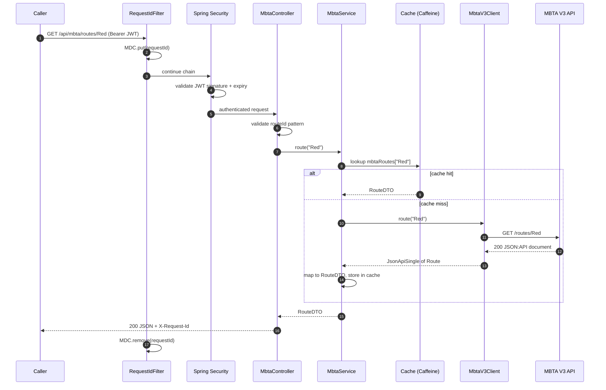
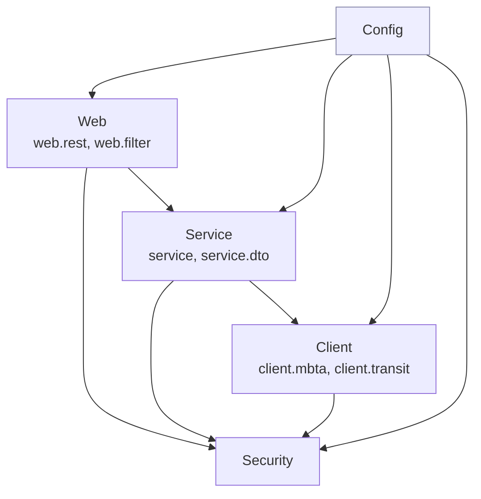

# Architecture
{: .no_toc }

<details open markdown="block">
  <summary>Contents</summary>
  {: .text-delta }
1. TOC
{:toc}
</details>

## Layered design

The code is organised **by technical layer**, and each layer has one job:

| Layer | Package | Responsibility | Must NOT |
|---|---|---|---|
| **Web** | `web.rest`, `web.filter` | HTTP: routing, request validation, status codes, headers | Contain business rules or call external APIs |
| **Service** | `service`, `service.dto` | Business logic: caching, metrics, mapping, domain errors | Know about HTTP status codes or request objects |
| *(API contract)* | `api.transit.v1` | Classes generated from our `transit.proto`; in no layer, so every layer may use them | Contain hand-written code |
| **Client** | `client.mbta`, `client.transit` | Talk to one external API: paths, verbs, payloads, upstream errors | Be used by controllers directly |
| **Security** | `security` | Security helpers and constants | Depend on web or service code |
| **Config** | `config` | Wire everything together (`@Configuration`, `@Bean`) | Be depended on by other layers |

### Request flow

A `GET /api/mbta/routes/Red` travels through the layers like this:



The combined route board adds a parallel fan-out to two clients; see [Route board](route-board.md).

### Dependency direction



Dependencies point **one way only**: down towards the outside world. Nothing depends on `config`, and nothing above
the service layer knows that an external API exists.

## The rules are enforced by a test

Architecture that only lives in a diagram erodes. `TechnicalStructureTest` uses
[ArchUnit](https://www.archunit.org) to fail the build when a dependency breaks the rules:

```java
@ArchTest
static final ArchRule respectsTechnicalArchitectureLayers = layeredArchitecture()
    .consideringAllDependencies()
    .layer("Config").definedBy("..config..")
    .layer("Client").definedBy("..client..")
    .layer("Web").definedBy("..web..")
    .optionalLayer("Service").definedBy("..service..")
    .layer("Security").definedBy("..security..")

    .whereLayer("Config").mayNotBeAccessedByAnyLayer()
    .whereLayer("Client").mayOnlyBeAccessedByLayers("Service", "Config")
    .whereLayer("Web").mayOnlyBeAccessedByLayers("Config")
    .whereLayer("Service").mayOnlyBeAccessedByLayers("Web", "Config")
    .whereLayer("Security").mayOnlyBeAccessedByLayers("Config", "Client", "Service", "Web")

    .ignoreDependency(belongToAnyOf(VoicebioApiApp.class), alwaysTrue())
    .ignoreDependency(alwaysTrue(), belongToAnyOf(com.example.config.ApplicationProperties.class));
```

These rules shaped several real decisions in this codebase:

* **Profile constants live in `com.example.SpringProfiles`, not in `config`.** The web and AOP code need the names
  `dev` and `prod`, and nothing may depend on `config`. The root package belongs to no layer.
* **The client has its own model.** `MbtaV3Client` cannot return `service.dto.MbtaDtos.RouteDTO`, because the client layer
  may not depend on the service layer. See [Two models, on purpose](#two-models-on-purpose).
* **`client` was opened to `Service` only.** The generated rule said nothing may use `client`. It was loosened
  deliberately, in a reviewed change, to `mayOnlyBeAccessedByLayers("Service", "Config")`. Controllers still cannot
  call external APIs directly.

{: .tip }
When ArchUnit fails, treat it as a design review prompt, not an obstacle to work around. Every failure in this
project pointed at a real coupling problem.

## Two models, on purpose

Every external API has two representations here:

| Upstream (theirs) | Package | Ours | Package |
|---|---|---|---|
| `JsonApiResource<MbtaAttributes.Route>` (JSON:API envelope, snake_case) | `client.mbta` | `RouteDTO` (flat, camelCase) | `service.dto` |
| `GtfsRealtime.VehiclePosition` (proto2, 28-message schema) | generated from `gtfs-realtime.proto` | `Vehicle` (proto3, our `transit.proto`) | `api.transit.v1` |

The services map between them:

```java
static RouteDTO toRoute(JsonApiResource<MbtaAttributes.Route> route) {
    MbtaAttributes.Route a = route.attributes();
    // ... directions zipped from direction_names + direction_destinations
    return new RouteDTO(route.id(), name, a.color(), a.textColor(), kind(a.type()), directions);
}
```

This is an **anti-corruption layer**: when MBTA changes its API (renames a field, changes the envelope), only the
client model and the mapper change, and callers of `/api/mbta/*` never notice. Our models also make different choices
from MBTA's: GTFS `route_type` 1 becomes `"kind": "SUBWAY"`, and JSON:API relationships become plain ids.

{: .note }
For many fields, use [MapStruct](https://mapstruct.org) (already on the build path) instead of hand-written mappers.
For a handful of fields, a static method is clearer.

## Key design decisions

| Decision | Chosen | Rejected | Why |
|---|---|---|---|
| Upstream HTTP client | `@HttpExchange` interface on `RestClient` | Hand-written `RestClient` calls, `WebClient`, OpenFeign | Declarative, Boot-configured, instrumented; WebClient adds reactive cost to a blocking app; OpenFeign is feature-complete/maintenance. See [HTTP clients](http-clients.md). |
| Concurrency model | Spring MVC + **virtual threads** | WebFlux | Simple blocking code that scales for I/O-bound work on Java 21. |
| DTOs | Java `record`s | Lombok `@Data` classes | Immutable, value equality, no generated code. |
| Dependency injection | Constructor injection, `final` fields | `@Autowired` on fields | Explicit dependencies, testable without Spring, immutable. |
| Boilerplate | Lombok **only** for `@Slf4j` | Lombok everywhere | Records and constructors already remove most boilerplate. |
| Error format | RFC 7807 `ProblemDetail` | Ad-hoc error JSON | Standard, machine-readable, built into Spring. See [Error handling](error-handling.md). |
| Upstream errors | Client throws client exceptions; service translates to domain errors | Service inspects HTTP status | Only the client understands HTTP; only the service knows which id was requested. |
| Config | `@ConfigurationProperties` + Boot standard properties | `@Value` everywhere | Type-safe, validated at startup, documented by metadata. |
| Auth in dev | Profile-gated token endpoint | Disabling security in dev | Dev runs the same security as prod; only the token source differs. |
| Combining sources | Parallel calls on a bounded virtual-thread executor, per-source timeout, partial result with `sources` status | Sequential calls; all-or-nothing | Latency of the slower call, not the sum; one dependency's outage degrades instead of failing. See [Route board](route-board.md). |
| Java version | **21 (LTS)** everywhere: compiler `release`, enforcer, container | Newest JDK | One supported runtime; matches the team's platforms. |
| Tracing | Dynatrace **OneAgent** (outside the code) | In-process tracer (OpenTelemetry) | One tracer per JVM; no tracing dependencies to upgrade. |
| Log shipping | Logback appenders per profile (Splunk HEC, Fluentd) | One vendor hard-wired | Same artifact everywhere; destinations chosen per environment. See [Logging & metrics platforms](vendor-integrations.md). |

## Coding conventions used throughout

* **Constructor injection** with `final` fields. A class with many constructor parameters is a signal to split it.
* **`record` for data**, regular classes for behaviour.
* **Package-private by default** for helpers (`MbtaV3ClientConfiguration.customize(...)` is package-private and still
  reachable from its test in the same package).
* **One `@Configuration` per concern** (`CacheConfiguration`, `MbtaV3ClientConfiguration`, `UpstreamExecutorConfiguration`...),
  not one giant config class.
* **Javadoc explains *why***; the code shows *what*. Comments such as "Tomcat reuses threads: a leftover id would be
  attached to the next request" encode knowledge the code cannot.
* **Constants for names that must match**: `MbtaService.ROUTES_CACHE` is referenced by both `@Cacheable` and
  `CacheConfiguration`; `MbtaV3Client.GROUP` by both the interface and its registration.
