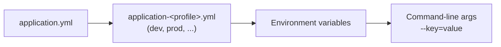

# Configuration
{: .no_toc }

<details open markdown="block">
  <summary>Contents</summary>
  {: .text-delta }
1. TOC
{:toc}
</details>

## Files and precedence

```
src/main/resources/config/
├── application.yml                  shared defaults for every environment
├── application-dev.yml              local development
├── application-prod.yml             production
├── application-secret-samples.yml   sample JWT secret (dev / CI only!)
└── application-tls.yml              HTTPS + HTTP/2 with a self-signed certificate
src/test/resources/config/
└── application.yml                  test configuration
```

Spring Boot merges these in order. **Later sources win**:



So the same jar runs everywhere, and each environment only overrides what differs. The Docker setup relies on this:
`src/main/docker/app.yml` sets `SPRING_PROFILES_ACTIVE=prod,api-docs,secret-samples` and
`MANAGEMENT_PROMETHEUS_METRICS_EXPORT_ENABLED=true` as environment variables, without changing the image.

{: .tip }
**Relaxed binding**: any property can be set as an environment variable by upper-casing it and replacing `.` and
`-` with `_`. `application.security.jwt.base64-secret` becomes `APPLICATION_SECURITY_JWT_BASE64_SECRET`.

## Profiles

| Profile | Activated by | What it changes |
|---|---|---|
| `dev` | Default (no profile given), `./mvnw` | DEBUG logging, devtools restart, pretty JSON, `LoggingAspect` tracing, dev token endpoint, 100% trace sampling |
| `prod` | `-Pprod` build or `SPRING_PROFILES_ACTIVE` | INFO logging, response compression, graceful shutdown, Prometheus export **off** (re-enable per environment) |
| `secret-samples` | Included in the `dev` group | Supplies a sample JWT signing secret. **Never in a real environment.** |
| `api-docs` | Included in the `dev` group | Turns on springdoc `/v3/api-docs` (disabled otherwise) |
| `tls` | `-Ptls` Maven profile | HTTPS with the bundled self-signed keystore, HTTP/2 |
| `json-logs` | Included in the `prod` group | JSON console logs for log shippers (Splunk, Datadog, Dynatrace, Loki) |
| `datadog` | `SPRING_PROFILES_ACTIVE` | Metrics to Datadog; needs `DATADOG_API_KEY` |
| `dynatrace` | `SPRING_PROFILES_ACTIVE` | App metrics to the local Dynatrace OneAgent (no token) |
| `splunk` | `SPRING_PROFILES_ACTIVE` | Logs to Splunk HEC; needs `SPLUNK_HEC_URL`, `SPLUNK_HEC_TOKEN` |
| `fluentd` | `SPRING_PROFILES_ACTIVE` | Logs to Fluentd / Doppler; needs `FLUENTD_HOST` |
| `test`, `testdev`, `testprod` | Set by the Maven Surefire/Failsafe configuration | Test settings; `AsyncConfiguration` is excluded so async runs synchronously in tests |

### Profile groups

One profile name can activate several. In `application.yml`:

```yaml
spring:
  profiles:
    active: '@spring.profiles.active@'   # filled in by Maven at build time
    group:
      dev:
        - secret-samples
        - api-docs
      prod:
        - json-logs
```

Running with `dev` therefore activates `dev, secret-samples, api-docs`, which is visible in the startup banner:

```
Application 'voicebioApi' is running! Access URLs:
	Profile(s): 	[dev, secret-samples, api-docs]
```

### Build-time profile filtering

`@spring.profiles.active@` is a **Maven resource-filtering placeholder**, not Spring syntax. The `pom.xml` filters
`config/**/*.yml` so the jar remembers which Maven profile built it (`dev` by default, `prod` with `-Pprod`). A
runtime `--spring.profiles.active` or `SPRING_PROFILES_ACTIVE` still overrides it.

If nothing is configured at all, `VoicebioApiApp.addDefaultProfile` sets `spring.profiles.default=dev`, and
`VoicebioApiApp.initApplication` logs an error if `dev` is combined with `prod` or `cloud`.

{: .note }
Profile names are constants in `com.example.SpringProfiles` (`DEVELOPMENT`, `PRODUCTION`...), so
`@Profile(SpringProfiles.DEVELOPMENT)` cannot silently break on a typo.

## Type-safe application properties

Settings that belong to this application live under the `application.*` namespace and are bound to
`com.example.config.ApplicationProperties`:

```java
@ConfigurationProperties(prefix = "application", ignoreUnknownFields = false)
public class ApplicationProperties {
    private final CorsConfiguration cors = new CorsConfiguration();
    private final Cache cache = new Cache();
    private final Security security = new Security();
    private final ApiDocs apiDocs = new ApiDocs();
    // getters, nested static classes with defaults...
}
```

```yaml
application:
  cache:
    caffeine:
      time-to-live-seconds: 3600
      max-entries: 100
  security:
    jwt:
      base64-secret: ...        # from secret-samples in dev; from the environment in prod
  api-docs:
    title: Voicebio API
    version: 0.0.1
```

Why `@ConfigurationProperties` instead of scattered `@Value("${...}")`:

| | `@ConfigurationProperties` | `@Value` |
|---|---|---|
| Typo in YAML key | **Startup fails** (`ignoreUnknownFields = false`) | Silently ignored or fails only where used |
| Types | `Duration`, lists, nested objects, validation | Strings and simple conversions |
| Discoverability | One class documents every setting; IDE auto-complete via `spring-boot-configuration-processor` | Spread across classes |
| Testing | `new ApplicationProperties()` in a unit test | Needs a Spring context |

{: .lesson }
`ignoreUnknownFields = false` caught real mistakes during development: a misspelled or outdated key under
`application.*` fails fast at startup instead of being ignored in production.

## Prefer Spring Boot's own properties

Before adding a custom property, check whether Boot already has one. Both MBTA clients are configured
through standard properties:

```yaml
spring:
  http:
    clients:
      imperative:
        factory: jdk                  # JDK HttpClient: supports PATCH
    serviceclient:
      mbta:                           # an HTTP interface group name
        base-url: https://api-v3.mbta.com
        connect-timeout: 5s
        read-timeout: 10s
      transit:
        base-url: https://cdn.mbta.com
        connect-timeout: 5s
        read-timeout: 10s
  threads:
    virtual:
      enabled: true
```

An earlier version had a custom `application.*` block for its client plus a hand-built client bean; moving to Boot's
`spring.http.serviceclient.<group>.*` deleted that code. Standard properties are documented, show up in IDE
completion, and behave the same way in every Boot application.

## Secrets

The JWT signing secret is the only secret. How it is supplied:

| Environment | Source |
|---|---|
| Dev, CI | `application-secret-samples.yml` (sample value, committed on purpose) |
| Tests | `src/test/resources/config/application.yml` |
| Production | `APPLICATION_SECURITY_JWT_BASE64_SECRET` environment variable, injected by the platform from a secret manager |
| Integration credentials | `SPLUNK_HEC_TOKEN`, `MBTA_API_KEY`, `DATADOG_API_KEY`... from the platform; startup fails if a profile is on without what it needs ([Logging & metrics platforms](vendor-integrations.md#fail-fast-on-missing-settings)) |

The container entrypoint also supports Docker/Kubernetes **file secrets**: `src/main/docker/jib/entrypoint.sh` turns
`VAR_FILE=/run/secrets/...` into `VAR` (`file_env` function), so secrets never need to appear in `docker inspect`.

{: .warning }
Anyone holding the HMAC secret can mint admin tokens. Never reuse the sample secret, and rotate the real one like a
password. See [Security](security.md#jwt-validation).

## Runtime-changeable settings

Some settings can change **without a restart**, through Actuator:

```bash
# Raise a logger to DEBUG for one investigation, then reset it
curl -X POST -H "Authorization: Bearer $TOKEN" -H 'Content-Type: application/json' \
  -d '{"configuredLevel":"DEBUG"}' localhost:8081/management/loggers/com.example.service
curl -X POST -H "Authorization: Bearer $TOKEN" -H 'Content-Type: application/json' \
  -d '{"configuredLevel":null}'    localhost:8081/management/loggers/com.example.service
```

`/management/env` and `/management/configprops` (admin only) show the **effective** configuration and where each
value came from. This is the fastest way to answer "which value is production actually using?".

## Best practices

* Keep **one artifact for all environments**; differences go in profiles and environment variables.
* Put **safe defaults** in `application.yml`, and only overrides in profile files.
* Use **`@ConfigurationProperties` with `ignoreUnknownFields = false`** for application settings.
* Use **Spring Boot's standard properties** whenever one exists.
* Use **`Duration`** (`5s`, `10m`) for time settings, not bare numbers with units in the name.
* **Never commit real secrets.** Sample secrets live in a profile named so nobody can mistake it for production.
* Name profiles in constants, and **fail fast** on contradictory combinations (`dev` + `prod`).
