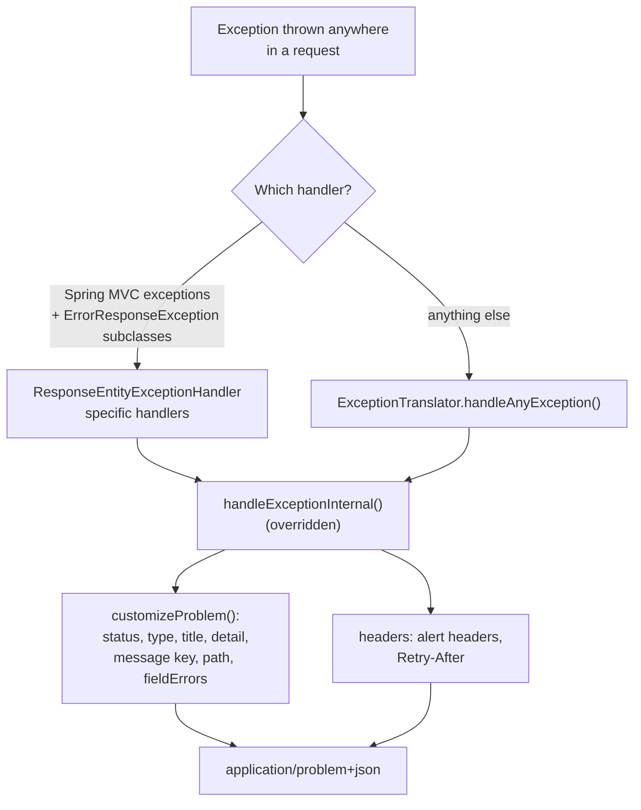

# Error handling
{: .no_toc }

<details open markdown="block">
  <summary>Contents</summary>
  {: .text-delta }
1. TOC
{:toc}
</details>

## One format for every error: RFC 7807

Every error this API returns, whether validation, an unknown route, an auth problem or an MBTA outage, uses **Problem
Details for HTTP APIs** ([RFC 7807](https://www.rfc-editor.org/rfc/rfc7807), updated by RFC 9457) with content type
`application/problem+json`:

```json
{
  "type": "urn:problem-type:voicebio:problem-with-message",
  "title": "Route not found",
  "status": 404,
  "detail": "Route NoSuchRoute does not exist",
  "instance": "/api/mbta/routes/NoSuchRoute",
  "message": "error.http.404",
  "path": "/api/mbta/routes/NoSuchRoute"
}
```

| Field | Meaning |
|---|---|
| `type` | Stable identifier of the *kind* of problem (`ErrorConstants`) |
| `title` | Short summary, the same for every occurrence of this kind |
| `status` | HTTP status, repeated in the body |
| `detail` | This occurrence (masked in production when it would leak internals) |
| `instance` | The request path |
| `message` | i18n key for UIs (`error.validation`, `error.http.404`...) |
| `fieldErrors` | For validation problems: one entry per invalid field or parameter |

## How it works



`web/rest/errors/ExceptionTranslator` is the **single** `@ControllerAdvice`. It extends Spring's
`ResponseEntityExceptionHandler`, so Spring's own exceptions use the same format, and adds a catch-all for everything
else.

### Status resolution, in order

1. The exception is an `ErrorResponse` (it carries its own status).
2. A **mapping in the translator** where we disagree with Spring's defaults: `AccessDeniedException` → 403,
   `BadCredentialsException` → 401, `ConstraintViolationException` → 400.
3. A **`@ResponseStatus` annotation** on the exception class (or its cause):

   ```java
   @ResponseStatus(value = HttpStatus.NOT_FOUND, reason = "Route not found")
   public class RouteNotFoundException extends RuntimeException { ... }          // service layer

   @ResponseStatus(value = HttpStatus.BAD_GATEWAY, reason = "MBTA API error")
   public class MbtaApiException extends RuntimeException { ... }                // client layer

   @ResponseStatus(value = HttpStatus.SERVICE_UNAVAILABLE, reason = "MBTA API rate limited")
   public class MbtaRateLimitedException extends RuntimeException implements RetryableFailure { ... }
   ```

   The `reason` becomes the problem `title`; the exception message becomes the `detail`.
4. Otherwise **500**.

{: .tip }
Prefer `@ResponseStatus` on your own exceptions. Services and clients throw meaningful exceptions without depending on
web classes, and the web layer turns them into the right status automatically.

## Upstream failures: 502, 503 and `Retry-After`

| Upstream situation | Our exception | Our response |
|---|---|---|
| MBTA 404 for a looked-up id | `RouteNotFoundException` (translated by the service) | **404** |
| MBTA 429 (rate limited) | `MbtaRateLimitedException` | **503** + `Retry-After: <seconds until MBTA's window resets>` |
| MBTA 5xx or other error | `MbtaApiException` | **502** `MBTA API error` |
| GTFS-Realtime feed error | `TransitFeedException` | **502** `Transit feed error` |
| Both route-board sources down | `RouteBoardUnavailableException` | **502** `Route board unavailable` |
| One route-board source down | (none: partial result) | **200** with `sources: {...: UNAVAILABLE}` |

```
HTTP/1.1 503
Retry-After: 42
Content-Type: application/problem+json

{"title":"MBTA API rate limited","status":503,"detail":"MBTA API rate limit reached, retry in 42 s", ...}
```

* **500** means "this service has a bug". **502** means "a server I depend on failed". **503** means "temporarily
  unavailable, try again". Alerts, retries and on-call routing all benefit from the distinction.
* **Not 429**: our caller did not exceed any limit of ours.
* `Retry-After` comes from `RetryableFailure`, a one-method interface in the root package. Any exception implementing
  it gets the header, without the web layer knowing about MBTA.

## Validation errors

### Request parameters

```java
@GetMapping("/stops/{stopId}/predictions")
public List<PredictionDTO> getPredictions(@PathVariable @Pattern(regexp = "[A-Za-z0-9._-]{1,64}") String stopId,
                                          @RequestParam(defaultValue = "10") @Min(1) @Max(50) int limit) { ... }
```

Constraint violations on parameters raise Spring 7's `HandlerMethodValidationException`, mapped to the same shape as
body validation:

```json
{
  "type": "urn:problem-type:voicebio:constraint-violation",
  "title": "Method argument not valid",
  "status": 400,
  "detail": "Invalid request parameters",
  "message": "error.validation",
  "fieldErrors": [{ "objectName": "request", "field": "limit", "message": "must be greater than or equal to 1" }]
}
```

{: .lesson }
Before this mapping existed, the response was a bare `"detail": "400 BAD_REQUEST \"Validation failure\""` with no field
information. The generated translator only knew body validation (`MethodArgumentNotValidException`).

### Request bodies

Bodies are validated with Bean Validation on the DTO and `@Valid` on the parameter
(`MethodArgumentNotValidException`), producing one `fieldErrors` entry per invalid field. This API is currently
read-only, so no endpoint takes a body; `ExceptionTranslatorIT.testMethodArgumentNotValid` keeps the behaviour tested
for the next one that does.

## Errors on protobuf endpoints

When a client asks for `application/x-protobuf` and the request fails, the error is still
`application/problem+json`: a problem has no protobuf form, and errors must stay readable. Protobuf clients should check
the status code and `Content-Type` before decoding ([Protocol Buffers](protobuf.md#errors-and-validation)).

## Production-safe messages

Exception messages often contain class names or hostnames. With the `prod` profile, `ExceptionTranslator` replaces:

* messages containing package-like strings (`org.`, `java.`, `com.`...) with **"Unexpected runtime exception"**
* `HttpMessageConversionException` messages with **"Unable to convert http message"**

The full exception is still in the logs, with the request id ([Logging](logging.md)).

{: .warning }
Write exception messages for API consumers: `"Route NoSuchRoute does not exist"`, not
`"NoSuchElementException in RouteRepository"`. Assume the `detail` can be shown to a user.

## Alert headers: `BadRequestAlertException`

For business-rule violations, a controller can throw `BadRequestAlertException`, which adds machine-readable headers:

```java
throw new BadRequestAlertException("A new thing cannot already have an ID", "thing", "idexists");
```

```
HTTP/1.1 400
X-voicebioApi-error: error.idexists
X-voicebioApi-params: thing
```

### Lesson: the headers were never sent
{: .text-purple-200 }

In the generated code, the headers were added only in the catch-all `handleAnyException`. But
`BadRequestAlertException` extends Spring's `ErrorResponseException`, and `ResponseEntityExceptionHandler` has a
**more specific** handler for that type; the most specific handler wins, so the headers were silently dropped. The fix
adds headers in `handleExceptionInternal`, which every path goes through. The regression test lives in
`ExceptionTranslatorIT.badRequestAlertSendsAlertHeaders`, independent of any feature controller.

{: .lesson }
When the Todo feature was removed, its controller test (the only test of the alert headers) went with it. Tests of
cross-cutting behaviour belong next to the cross-cutting code, not inside a feature that may disappear.

## Status code guide for this API

| Status | When | Example |
|---|---|---|
| 200 OK | Successful read | `GET /api/mbta/routes/Red`, a partial route board |
| 400 Bad Request | Invalid input | `limit=0`; `/api/mbta/routes/Red Line!` |
| 401 Unauthorized | No or invalid token | Request without `Authorization` |
| 403 Forbidden | Valid token, missing role | `ROLE_USER` calling `/management/metrics` |
| 404 Not Found | The resource does not exist | `GET /api/mbta/routes/NoSuchRoute` |
| 502 Bad Gateway | A dependency failed | MBTA 5xx; GTFS feed down |
| 503 Service Unavailable | A dependency is temporarily refusing (with `Retry-After`) | MBTA rate limit |
| 500 Internal Server Error | A bug in this service | Unexpected exception |

## Best practices

* **One `@ControllerAdvice`**, one error format (RFC 7807), for every endpoint.
* **Domain exceptions with `@ResponseStatus`**; no HTTP types in services.
* **Distinguish 500, 502 and 503**, and send `Retry-After` when the caller should retry.
* **Validate at the edge**, including path and query values, and return field-level errors.
* **Mask internals in production**; log the full exception with a correlation id.
* **Test error responses** (status, body, headers) next to the error-handling code.
