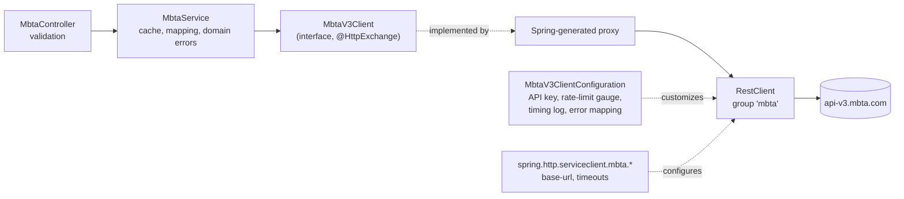
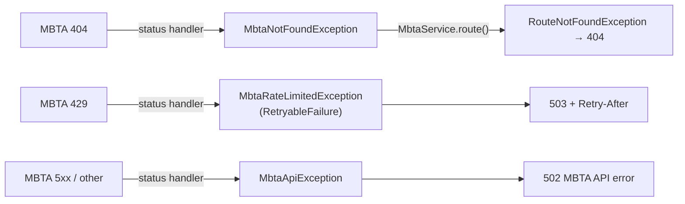

# Calling REST APIs: the MBTA V3 client
{: .no_toc }

<details open markdown="block">
  <summary>Contents</summary>
  {: .text-delta }
1. TOC
{:toc}
</details>

## Choosing a client

For a Spring MVC service on Java 21 the choice is clear:

| Client | Style | Status | Use it when |
|---|---|---|---|
| `RestTemplate` | Blocking, template methods | **Maintenance only** | Never in new code |
| **`RestClient`** | Blocking, fluent | Current default for MVC | **Servlet apps (this one)** |
| `WebClient` | Non-blocking, Reactor `Mono`/`Flux` | Current | WebFlux apps, streaming |
| Spring Cloud OpenFeign | Declarative interface | Feature-complete; Spring recommends HTTP interfaces | Existing Feign code only |
| **HTTP interfaces** (`@HttpExchange`) | Declarative interface over `RestClient` | First-class in Spring Boot 4 | **Every client here** |

`WebClient` only pays off in a reactive stack. In Spring MVC every call ends in `.block()`, and reactive thread hopping
breaks the `ThreadLocal`-based MDC used for request correlation. **Virtual threads** (`spring.threads.virtual.enabled:
true`) remove the old scalability argument: a request waiting on MBTA parks a cheap virtual thread.

This service has two clients built the same way:

| Client | API | Format | Page |
|---|---|---|---|
| `MbtaV3Client` | MBTA V3 REST API (`api-v3.mbta.com`) | JSON:API | this page |
| `GtfsRealtimeClient` | MBTA GTFS-Realtime feed (`cdn.mbta.com`) | Protocol Buffers | [Protocol Buffers](protobuf.md) |

## The MBTA V3 API

[MBTA V3](https://api-v3.mbta.com/docs/swagger) is Boston's public transit API: routes, stops, predictions, alerts,
vehicles. It is a good practice target because it has everything real APIs have:

* **[JSON:API](https://jsonapi.org)** documents (`data`, `attributes`, `relationships`, `included`), media type
  `application/vnd.api+json`
* **bracketed query parameters**: `filter[route]=Red`, `fields[stop]=name`, `page[limit]=5`
* **includes**: related resources returned in the same response (`include=child_stops`)
* **rate limiting**: 20 requests/minute without a key, 1,000 with a free key, signalled by `x-ratelimit-*` headers
* **real errors**: 404 with a JSON:API error document, 429 when rate limited

Our API exposes it as plain JSON:

| Our endpoint | MBTA V3 call | Cached |
|---|---|---|
| `GET /api/mbta/routes?types=0,1` | `/routes?filter[type]=0,1` | 1 h |
| `GET /api/mbta/routes/{routeId}` | `/routes/{id}` | 1 h |
| `GET /api/mbta/routes/{routeId}/stations` | `/stops?filter[route]=…&include=child_stops&fields[stop]=…` | 1 h |
| `GET /api/mbta/routes/{routeId}/alerts` | `/alerts?filter[route]=…` | 15 s |
| `GET /api/mbta/stops/{stopId}/predictions?routeId=&limit=` | `/predictions?filter[stop]=…&sort=arrival_time&page[limit]=…` | 15 s |

## The design: interface + configuration + service



### 1. The client is an interface

```java
@HttpExchange(accept = MbtaV3Client.JSON_API)
public interface MbtaV3Client {
    String GROUP = "mbta";
    String JSON_API = "application/vnd.api+json";

    @GetExchange("/routes")
    JsonApiDocument<Route> routes(@RequestParam("filter[type]") String types);

    @GetExchange("/routes/{id}")
    JsonApiSingle<Route> route(@PathVariable String id);

    @GetExchange("/stops?include=child_stops&fields[stop]=name,platform_name,location_type,latitude,longitude")
    JsonApiDocument<Stop> stationsWithPlatforms(@RequestParam("filter[route]") String routeId);

    @GetExchange("/predictions?sort=arrival_time")
    JsonApiDocument<Prediction> predictions(@RequestParam("filter[stop]") String stopId,
                                            @RequestParam(name = "filter[route]", required = false) String routeId,
                                            @RequestParam("page[limit]") int limit);

    @GetExchange("/alerts?fields[alert]=header,effect,severity,lifecycle,active_period")
    JsonApiDocument<Alert> alerts(@RequestParam("filter[route]") String routeId);
}
```

* Bracketed JSON:API parameters are ordinary `@RequestParam` names; they go out percent-encoded
  (`filter%5Broute%5D=Red`), which MBTA accepts.
* Fixed parameters (`include`, `fields`, `sort`) sit in the URL template; variable ones are method parameters.
* An optional parameter that is `null` is left out of the URL.

### 2. Modelling JSON:API

The envelope is generic; only `attributes` differ per resource type:

```java
public record JsonApiDocument<A>(List<JsonApiResource<A>> data, List<JsonApiResource<A>> included) { }
public record JsonApiSingle<A>(JsonApiResource<A> data) { }
public record JsonApiResource<A>(String id, String type, A attributes, Map<String, JsonApiRelationship> relationships) {
    public Optional<String> relatedId(String relationship) { ... }
}
```

A relationship's `data` is **one object** for to-one relationships (`"parent_station": {"data": {"id": ...}}`) and an
**array** for to-many (`"child_stops": {"data": [...]}`), and `null` when empty. One Jackson feature reads all three
into a list:

```java
public record JsonApiRelationship(@JsonFormat(with = JsonFormat.Feature.ACCEPT_SINGLE_VALUE_AS_ARRAY) List<Identifier> data) {
    public record Identifier(String id, String type) { }
}
```

Attributes are records with only the fields we use, mapped from snake_case with `@JsonProperty("long_name")`; MBTA's
other fields are ignored. `MbtaV3ClientConfigurationTest.readsToOneAndToManyRelationshipsTheSameWay` pins the behaviour.

### 3. Registration and customization

```java
@Configuration
@ImportHttpServices(group = MbtaV3Client.GROUP, types = MbtaV3Client.class)
public class MbtaV3ClientConfiguration {

    @Bean
    public RestClientHttpServiceGroupConfigurer mbtaClientGroupConfigurer(ApplicationProperties properties, MeterRegistry meterRegistry) {
        AtomicInteger remaining = new AtomicInteger(-1);
        Gauge.builder("mbta.ratelimit.remaining", remaining, AtomicInteger::get).register(meterRegistry);
        return groups -> groups.filterByName(MbtaV3Client.GROUP)
            .forEachClient((group, builder) -> customize(builder, properties.getMbta().getApiKey(), remaining, Clock.systemUTC()));
    }

    static RestClient.Builder customize(RestClient.Builder builder, String apiKey, AtomicInteger remaining, Clock clock) {
        if (StringUtils.hasText(apiKey)) builder.defaultHeader("x-api-key", apiKey);  // only when configured
        return builder
            .requestInterceptor(OutboundCallLogging.timingLog("MBTA V3"))
            .requestInterceptor(rateLimitTracker(remaining))                         // reads x-ratelimit-remaining
            .defaultStatusHandler(HttpStatusCode::isError, (request, response) -> {
                // 404 -> MbtaNotFoundException, 429 -> MbtaRateLimitedException(retry-after), else MbtaApiException
            });
    }
}
```

```yaml
spring:
  http:
    clients:
      imperative:
        factory: jdk                 # JDK HttpClient (HTTP/2; supports PATCH)
    serviceclient:
      mbta:
        base-url: https://api-v3.mbta.com
        connect-timeout: 5s
        read-timeout: 10s
application:
  mbta:
    api-key: ${MBTA_API_KEY:}        # optional: 20 -> 1000 requests/minute
```

Spring Boot provides the rest for every group: base URL and timeouts, the request factory, Micrometer instrumentation
(`http.client.requests`), and all `RestClientCustomizer` beans.

### 4. The service sees only Java

```java
@Cacheable(cacheNames = ROUTES_CACHE, key = "#routeId")
public RouteDTO route(String routeId) {
    try {
        return toRoute(client.route(routeId).data());
    } catch (MbtaNotFoundException e) {
        throw new RouteNotFoundException(routeId);       // upstream 404 -> our domain 404
    }
}
```

`MbtaService` maps JSON:API to flat DTOs (`RouteDTO`, `StationDTO`, `PredictionDTO`, `AlertDTO`), so the JSON:API
envelope never reaches our callers ([Architecture](architecture.md#two-models-on-purpose)).

## Rate limiting: design for the limit you have

Without an API key, MBTA allows **20 requests per minute** per client IP. The design keeps well inside it:

| Mechanism | Effect |
|---|---|
| Caches sized to data volatility | Routes and stations: 1 h. Predictions and alerts: 15 s. |
| One call for stations + platforms | `include=child_stops` instead of one call per station |
| Optional `MBTA_API_KEY` | Sent as `x-api-key` only when set; raises the limit to 1,000/min |
| `mbta.ratelimit.remaining` gauge | Read from every response's `x-ratelimit-remaining`; alert before you hit 0 |
| 429 → **503 + `Retry-After`** | The reset time from `x-ratelimit-reset` becomes the caller's `Retry-After` |

Measured: a full live Karate run (25 scenarios) plus a 90-request Gatling run made **11 calls** to MBTA and received
**0** rate-limit responses.

{: .note }
Why 503 and not 429? **429** tells the caller "*you* sent too many requests". Our caller did not exceed any limit of
ours; a dependency is temporarily unavailable, which is **503 Service Unavailable**. `Retry-After` comes from a small
`RetryableFailure` interface (root package) that the client exception implements and the error handler reads.

## Error handling across the boundary



* The **client configuration** understands HTTP statuses and headers.
* The **service** knows what was looked up, so it turns "MBTA said 404 for this route" into `RouteNotFoundException`.
* `MbtaNotFoundException` **extends** `MbtaApiException`: an untranslated 404 (a broken path, say) is a 502, not a
  misleading 404.

## Validate before calling upstream

Path and query values flow into the upstream URL, cache keys and log lines, so the controller validates them first:

```java
@GetMapping("/routes/{routeId}")
public RouteDTO getRoute(@PathVariable @Pattern(regexp = "[A-Za-z0-9._-]{1,64}") String routeId) { ... }

@GetMapping("/stops/{stopId}/predictions")
public List<PredictionDTO> getPredictions(..., @RequestParam(defaultValue = "10") @Min(1) @Max(50) int limit) { ... }
```

`MbtaControllerIT.pathValuesAreValidatedBeforeReachingUpstream` checks that `/api/mbta/routes/Red Line!` is a 400 and
that the service is never called.

## Timeouts are mandatory

Every client group sets `connect-timeout` and `read-timeout`. The combined route board adds a **per-source budget**
(4 s) on top, so one slow dependency cannot hold a request ([Route board](route-board.md)).

## Lessons learned

### Lesson: an empty default is a value
{: .text-purple-200 }

Twice, a `${VAR:}` placeholder (default: empty) silently broke an integration:

* `application-key: ${DATADOG_APP_KEY:}` made Micrometer send **56 metadata requests** per publish, all rejected.
* `uri: ${DYNATRACE_METRICS_URI:}` replaced Micrometer's OneAgent endpoint with an empty one; the startup log said
  `Exporting to endpoint ` and **no metrics were sent**.

The MBTA API key avoids the trap in code (`if (StringUtils.hasText(apiKey))`), and `apiKeyIsSentOnlyWhenConfigured`
tests both cases.

### Lesson: PATCH and null fields
{: .text-purple-200 }

An earlier client (since replaced) sent `{"title": null, "completed": true}` for a partial update, and the upstream
erased the title: Jackson writes nulls by default. Upstream models used for writes need
`@JsonInclude(JsonInclude.Include.NON_NULL)`, and a test must assert the **exact** body sent.

### Lesson: keep URI templates
{: .text-purple-200 }

Metrics are tagged with the URI **template** (`/routes/{id}`), never `/routes/Red`. Otherwise every id becomes a time
series (cardinality explosion). HTTP interfaces keep templates automatically.

## Recipe: adding a new REST client

1. Create `client/<api>/<Api>Client.java` as an `@HttpExchange` interface, plus records for the upstream payloads.
2. Register it with `@ImportHttpServices(group = "<api>", types = <Api>Client.class)` in a `config/<Api>ClientConfiguration`.
3. Configure `spring.http.serviceclient.<api>.base-url`, `connect-timeout` and `read-timeout`.
4. Map error statuses (404, 429, 5xx) to client exceptions in a `RestClientHttpServiceGroupConfigurer`.
5. Call it from a **service**, never a controller; map upstream models to your DTOs there; cache by data volatility.
6. Test it with `MockRestServiceServer` and real-shaped fixtures (see `MbtaV3ClientConfigurationTest`), then once
   against the real API.
7. Learn the API's limits (rate, size) before the first load test.
