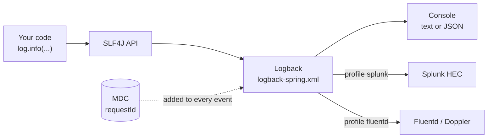
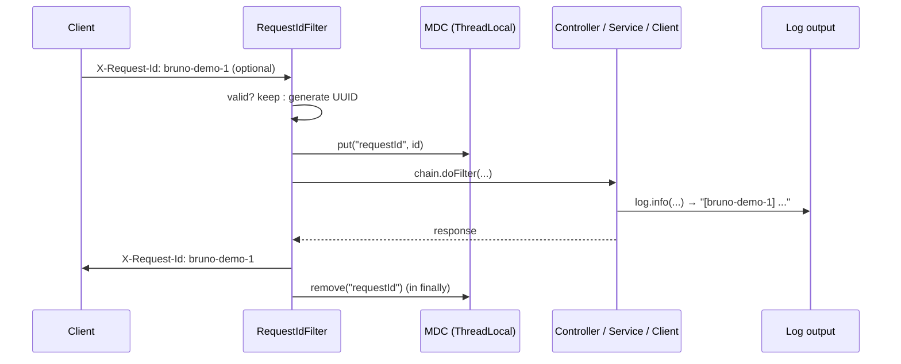

# Logging
{: .no_toc }

<details open markdown="block">
  <summary>Contents</summary>
  {: .text-delta }
1. TOC
{:toc}
</details>

## The stack



Code only ever uses the **SLF4J API**. Logback, the implementation, is configured in `logback-spring.xml`, and
`-spring` in the name lets it use Spring properties and profiles.

## Declaring a logger: `@Slf4j`

```java
@Slf4j
@Service
public class MbtaService {
    public RouteDTO route(String routeId) {
        log.info("Fetching MBTA route {}", routeId);
        ...
    }
}
```

`@Slf4j` is Lombok; at compile time it generates exactly:

```java
private static final org.slf4j.Logger log = org.slf4j.LoggerFactory.getLogger(MbtaService.class);
```

| | `@Slf4j` | `LoggerFactory.getLogger(X.class)` |
|---|---|---|
| Runtime behaviour | Identical | Identical |
| Copy-paste bug (`getLogger(OtherClass.class)`) | Impossible | Common |
| Dynamic logger names | No | Yes |
| Extra dependency | Lombok (compile time only, excluded from the jar) | None |

**Convention here:** use `@Slf4j` everywhere. Use `LoggerFactory` only when the logger name is computed at runtime,
as in `LoggingAspect`, which logs on behalf of whichever class it intercepts:

```java
private Logger logger(JoinPoint joinPoint) {
    return LoggerFactory.getLogger(joinPoint.getSignature().getDeclaringTypeName());
}
```

## Writing good log statements

```java
// ✅ placeholders: the message is only built if INFO is enabled
log.info("Serving {} vehicles on route {}", vehicles.size(), routeId);

// ❌ concatenation: the string is built even when the level is off
log.debug("Serving " + vehicles.size() + " vehicles on route " + routeId);

// ✅ exception as the LAST argument, after the placeholder values: the stack trace is printed
log.error("MBTA API {} {} returned {}", method, uri, status, exception);

// ❌ only the message is logged, the stack trace is lost
log.error("Failed: " + e.getMessage());
```

### Choosing a level

| Level | Use for | Example in this codebase |
|---|---|---|
| `ERROR` | A failure needing attention; usually alerts | An unexpected exception in a request |
| `WARN` | Unexpected but handled; or something that must be noticed | Dev token issued; outbound call failed with I/O error |
| `WARN` (also) | A degraded result | "Route board Red: source gtfsRealtime unavailable" |
| `INFO` | Business events and outbound calls, a few per request at most | "Fetching MBTA route Red", "MBTA V3 GET ... -> 200 (41 ms)" |
| `DEBUG` | Developer detail, off in production | "REST request to get live board of route Red", `LoggingAspect` enter/exit |
| `TRACE` | Very verbose internals | Not used |

Levels per environment: `dev` sets `com.example: DEBUG`; `prod` sets `com.example: INFO`.

### Never log

* Tokens, passwords, API keys: `DevTokenController.TokenResponse.toString()` returns `idToken=***` for this reason.
* Full request or response bodies containing personal data.
* Anything at INFO inside a tight loop.

## Automatic method tracing (dev only)

`aop/logging/LoggingAspect` wraps every `@Service`, `@RestController` and `@Repository` in `com.example` and, only
under the `dev` profile (`LoggingAspectConfiguration`):

* logs `Enter: route() with argument[s] = [Red]` and `Exit: route() with result = RouteDTO[...]` at DEBUG
* logs every thrown exception at ERROR with its cause (in dev with the full stack trace)

This is a debugging aid, not production logging: it logs arguments and results, which can be large or sensitive,
which is why it is profile-gated.

{: .note }
Because the aspect logs **every** exception in dev, an expected 404 (`RouteNotFoundException`) appears as an ERROR
with a stack trace in the dev console. That is the aspect being thorough, not a failure.

## Correlating a request: MDC

With many concurrent requests, log lines interleave. The **Mapped Diagnostic Context** (MDC) is a per-thread map
whose values Logback adds to every line, so all the lines of one request can be found together.

### How the request id flows



`web/filter/RequestIdFilter`:

```java
@Component
@Order(Ordered.HIGHEST_PRECEDENCE)        // before Spring Security: 401s are correlated too
public class RequestIdFilter extends OncePerRequestFilter {
    protected void doFilterInternal(HttpServletRequest request, HttpServletResponse response, FilterChain chain) ... {
        String requestId = resolveRequestId(request.getHeader(HEADER));
        MDC.put(MDC_KEY, requestId);
        response.setHeader(HEADER, requestId);
        try {
            chain.doFilter(request, response);
        } finally {
            MDC.remove(MDC_KEY);          // Tomcat reuses threads
        }
    }
}
```

The result, for one route-board request sent with `X-Request-Id: board-1`. The request thread and the two parallel
upstream calls (on virtual threads `upstream-1/2`) all carry the id:

```
DEBUG [mcat-handler-13] [board-1] RouteBoardController : REST request to get live board of route Red
INFO  [     upstream-2] [board-1] OutboundCallLogging  : Transit feed GET https://cdn.mbta.com/realtime/VehiclePositions.pb -> 200
INFO  [     upstream-2] [board-1] TransitService       : Serving 22 vehicles on route Red
INFO  [mcat-handler-13] [board-1] RouteBoardService    : Route board Red: 22 vehicles, sources {v3=OK, gtfsRealtime=OK}
```

`grep board-1` returns the whole journey; in Splunk it is a field search on `event.properties.requestId`, in Fluentd
records a `requestId` field. A caller (or the gateway) that sends its own id gets cross-service
correlation for free: the same id appears in every service's logs.

### The three MDC rules

1. **Always clear in `finally`.** Server threads are pooled; a forgotten value leaks into the next, unrelated request
   and makes logs actively misleading.
2. **Validate anything that comes from the client.** MDC values are printed with `%X{...}`, which is **not** covered
   by the CRLF-sanitizing `%crlf(%m)` converter. A header containing a newline could forge fake log lines. The filter
   only trusts `[A-Za-z0-9._-]{1,64}`; `RequestIdFilterTest.replacesIdThatCouldForgeLogLines` proves it.
3. **Propagate across threads.** MDC is a `ThreadLocal`; work handed to another thread starts with an empty MDC.

### Propagating MDC to `@Async` work

`config/MdcTaskDecorator` copies the caller's MDC onto the worker thread and restores the worker's own MDC afterwards.
It is installed on the async executor:

```java
executor.setTaskDecorator(new MdcTaskDecorator());   // AsyncConfiguration
```

```java
public Runnable decorate(Runnable runnable) {
    Map<String, String> callerContext = MDC.getCopyOfContextMap();     // captured on the caller thread
    return () -> {
        Map<String, String> previous = MDC.getCopyOfContextMap();
        setContext(callerContext);
        try { runnable.run(); } finally { setContext(previous); }      // leave the pool thread as found
    };
}
```

{: .note }
Virtual threads do not change this: they are still threads, MDC is still per thread, and `MDC.put` and `remove` in a
filter work the same way.

## The log pattern

`logback-spring.xml` prints, after the thread name, the request id and (when tracing is enabled) Spring Boot's
correlation pattern:

```
%clr([%15.15t]){faint}%clr(%replace( [%X{requestId}]){' \[\]', ''}){yellow} ${LOG_CORRELATION_PATTERN:-}...
```

* `%X{requestId}` reads the MDC value.
* `%replace(...)` removes the empty `[]` on lines that have no request (startup, scheduled jobs).
* `${LOG_CORRELATION_PATTERN:-}` is filled by Spring Boot with `[traceId-spanId]` only when an in-process tracer is
  present. Tracing is now done by Dynatrace OneAgent (not in-process), so it is empty; OneAgent's log enrichment adds
  `dt.trace_id` instead ([Logging & metrics platforms](vendor-integrations.md#dynatrace-oneagent)).

{: .lesson }
The original pattern defined its own `CONSOLE_LOG_PATTERN` without `%X{...}`, so **any** MDC value was silently
dropped from the console. If expected fields never show up in your logs, check the pattern first.

## JSON logs for production

Machines read JSON, not text: the platform, OneAgent and any stdout collector. The **`json-logs`**
profile switches the console to Spring Boot's structured logging, and it is **active in `prod` automatically** (profile
group in `application.yml`):

```yaml
# application-json-logs.yml
logging:
  structured:
    format:
      console: logstash
    json:
      add:
        service: ${spring.application.name}
        env: ${DEPLOY_ENV:local}
        version: '@project.version@'
```

Every line becomes one JSON object, and **all MDC values become fields** (`requestId`), so they
are searchable without parsing text. No extra dependency is needed. Example output and Splunk searches are on the
[Logging & metrics platforms](vendor-integrations.md) page.

{: .lesson }
With a custom `logback-spring.xml`, setting `logging.structured.format.console` **does nothing** on its own: Boot's
`console-appender.xml` always uses the text pattern. `logback-spring.xml` therefore includes
`structured-console-appender.xml` under `<springProfile name="json-logs">`. Verify by looking at real output: the first
attempt "worked" in configuration and produced zero JSON lines.

## Shipping logs: Splunk HEC and Fluentd

Two more appenders, each behind a profile, send every event (with its MDC) to the log platforms:

| Profile | Appender | Delivery |
|---|---|---|
| `splunk` | `HttpEventCollectorLogbackAppender` behind an `AsyncAppender` (`neverBlock`) | HTTPS batches of up to 100 events or 2 s, 3 retries |
| `fluentd` | `FluencyLogbackAppender` | Forward protocol, in-memory buffer (64 MB cap), retries, flushed on shutdown |

Both are asynchronous: a slow or unreachable log platform never blocks a request. Configuration, verified payloads
and searches: [Logging & metrics platforms](vendor-integrations.md).

## Changing levels at runtime

Actuator's `loggers` endpoint (admin only) changes a level on a running instance, with no restart:

```bash
curl -H "Authorization: Bearer $TOKEN" localhost:8081/management/loggers/com.example.service
curl -X POST -H "Authorization: Bearer $TOKEN" -H 'Content-Type: application/json' \
     -d '{"configuredLevel":"DEBUG"}' localhost:8081/management/loggers/com.example.service
```

Reset with `{"configuredLevel": null}`. The Bruno folder *6 Observability* has these requests.

## Best practices

* **SLF4J API only**; one logger declaration style per codebase (`@Slf4j` here).
* **Placeholders, not concatenation**; **exception last** to keep stack traces.
* **INFO tells the story** of a request in a few lines; DEBUG is for developers.
* **Correlate** every request with an id in MDC; accept an incoming id, validate it, return it.
* **Clear MDC in `finally`** and **propagate it** to other threads.
* **JSON logs** in production; human-readable text in development.
* **Never log secrets**; mask them in `toString()`.
