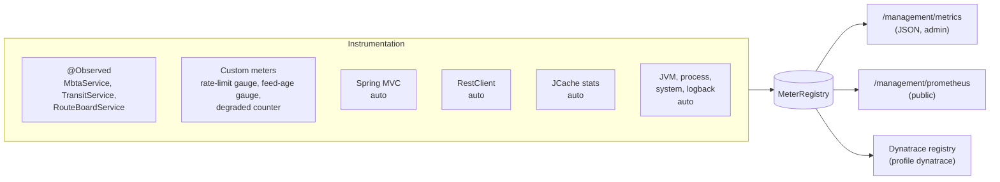

# Observability: metrics, health and tracing
{: .no_toc }

<details open markdown="block">
  <summary>Contents</summary>
  {: .text-delta }
1. TOC
{:toc}
</details>

## The three signals

| Signal | Answers | Here |
|---|---|---|
| **Logs** | What happened to *this* request? | SLF4J + Logback, MDC `requestId`, shipped to Splunk / Fluentd ([Logging](logging.md)) |
| **Metrics** | How is the system behaving *overall*? | Micrometer → Prometheus (→ CloudWatch), Dynatrace |
| **Traces** | Where did the time go *across services*? | Dynatrace OneAgent (PurePaths), no tracer in the app |

Where each signal is shipped is described in [Logging & metrics platforms](vendor-integrations.md). This page is
about **producing** good signals.

## Micrometer in one picture



Micrometer is to metrics what SLF4J is to logging: a **vendor-neutral facade**. The code records metrics once;
registries export them.

## The metrics this service produces

| Metric | Type | Source | Key tags |
|---|---|---|---|
| `mbta.service` | Timer (+ histogram) | `@Observed` on `MbtaService` | `method`, `error` |
| `transit.service` | Timer | `@Observed` on `TransitService` | `method`, `error` |
| `route.board` | Timer | `@Observed` on `RouteBoardService` | `method`, `error` |
| `route.board.degraded` | Counter | `RouteBoardService` | `source` (`v3`, `gtfsRealtime`) |
| `mbta.ratelimit.remaining` | Gauge | `x-ratelimit-remaining` of every MBTA response | |
| `transit.feed.age` | Gauge (seconds) | Age of the GTFS-Realtime data served | |
| `http.server.requests` | Timer | Spring MVC, automatic | `uri` (template), `method`, `status`, `outcome` |
| `http.client.requests` | Timer | `RestClient`, automatic | `client.name`, `uri` (template), `status` |
| `cache.gets` | Counter | Caffeine/JCache statistics | `cache`, `result` (`hit`/`miss`) |
| `security.authentication.invalid-tokens` | Counter | `SecurityMetersService` | `cause` |
| `jvm.*`, `process.*`, `system.*`, `logback.events` | various | automatic | |

All carry `application=voicebioApi` and `env=${DEPLOY_ENV:local}` (`management.metrics.tags`).

## Timing with `@Observed`

```java
@Service
@Observed(name = "mbta.service", contextualName = "mbta-service")
public class MbtaService { ... }
```

```yaml
management:
  observations:
    annotations:
      enabled: true      # activates the aspect that processes @Observed
```

One annotation times **every public method** as one metric with a `method` tag, and records failures with an `error`
tag (the exception type), so latency and error rate come from the same metric:

```
voicebio.mbta.service,application=voicebioApi,method=stations,env=local,error=none,class=com.example.service.MbtaService gauge,min=149,max=149,...
```

{: .note }
`@Observed`, `@Cacheable` and `@Transactional` work through Spring proxies: they do not apply to private methods or to
calls from one method of the same class to another. That is why the cached GTFS feed lives in its own bean
(`CachedVehicleFeed`).

## Gauges for dependency health

Two gauges watch the **dependencies**, not the application:

```java
// MbtaV3ClientConfiguration: updated from every MBTA response
Gauge.builder("mbta.ratelimit.remaining", remaining, AtomicInteger::get).register(meterRegistry);

// TransitService: seconds since MBTA generated the feed we last served
Gauge.builder("transit.feed.age", this, TransitService::feedAgeSeconds).baseUnit("seconds").register(meterRegistry);
```

Alert on `mbta_ratelimit_remaining` approaching 0 (before users get 503) and on `transit_feed_age_seconds` growing
(the upstream has stopped updating, and our data is going stale while every request still "succeeds").

### Lesson: Prometheus renamed a counter
{: .text-purple-200 }

An early custom counter was named `todos.created`. In `/management/metrics` it looked fine; in Prometheus it appeared as
`todos_total`: OpenMetrics reserves the `_created` suffix, and the Prometheus client strips it. Check new metrics where
they are consumed (the scrape, and here the CloudWatch metrics the Lambda creates from it), and avoid names ending in
`created`, `total`, `count`, `sum`, `bucket` or `info`.

## Automatic HTTP metrics and cardinality

Spring instruments both directions of HTTP with no code. For upstream calls, the tags show which dependency, which
template and which outcome:

```
http_client_requests_seconds_count{client_name="api-v3.mbta.com",method="GET",outcome="SUCCESS",status="200",uri="/routes/{id}"} 3
http_client_requests_seconds_count{client_name="api-v3.mbta.com",method="GET",outcome="CLIENT_ERROR",status="404",uri="/routes/{id}"} 1
http_client_requests_seconds_count{client_name="cdn.mbta.com",method="GET",outcome="SUCCESS",status="200",uri="/realtime/VehiclePositions.pb"} 1
```

**`uri="/routes/{id}"` is a template, not `/routes/Red`.** Each distinct tag combination is a separate time series
held in memory by Prometheus (and becomes a CloudWatch metric via the Lambda, which costs money per metric). Tagging
with raw ids, user ids or full URLs creates unbounded series: a *cardinality explosion*.

{: .warning }
A tag's values must be a **small, bounded set** (method, status, outcome, URI template, cache name, source). Unbounded
values (ids, request ids) belong in logs and traces, never in metric tags. The Karate `observability.feature` asserts
that no `uri` tag contains a route id.

## Histograms and percentiles

```yaml
management:
  metrics:
    distribution:
      percentiles-histogram:
        all: true
```

This publishes **histogram buckets** for every timer, so percentiles are computed by the backend:

```promql
# p95 latency of each MBTA service method
histogram_quantile(0.95, sum by (le, method) (rate(mbta_service_seconds_bucket[5m])))

# Share of route boards served degraded, per missing source
sum by (source) (rate(route_board_degraded_total[5m])) / scalar(sum(rate(route_board_seconds_count[5m])))

# Cache hit ratio of MBTA reference data
sum(rate(cache_gets_total{cache="mbtaRoutes",result="hit"}[5m])) / sum(rate(cache_gets_total{cache="mbtaRoutes"}[5m]))
```

Bucket-based percentiles can be **aggregated across instances**; pre-computed percentiles cannot (averaging p95s is
mathematically wrong).

## Actuator endpoints

Base path `/management`. Exposed:

| Endpoint | Access | Use |
|---|---|---|
| `health`, `health/liveness`, `health/readiness` | Public | Load balancer and Kubernetes probes |
| `info` | Public | Build and git info |
| `prometheus` | Public | Prometheus and the CloudWatch Lambda (**off** in `prod` unless `MANAGEMENT_PROMETHEUS_METRICS_EXPORT_ENABLED=true`) |
| `metrics`, `metrics/{name}` | Admin | Ad-hoc inspection (Bruno *3 Observability*) |
| `loggers` | Admin | Read and change log levels at runtime |
| `env`, `configprops` | Admin | Effective configuration (values masked as `******`) |
| `caches`, `threaddump`, `logfile` | Admin | Diagnostics |

**Liveness** failing means "restart me"; **readiness** failing means "stop sending traffic for now". MBTA is
deliberately in **neither**: an MBTA outage must not restart our instances or take them out of rotation. It shows up
as 502/503 responses, `route.board.degraded`, and the dependency gauges instead.

## Tracing: Dynatrace OneAgent

The application contains **no tracer**. OneAgent instruments the JVM at runtime: incoming requests, both MBTA clients,
the parallel calls of the route board, and exceptions, all stitched into distributed traces (PurePaths). W3C
`traceparent` headers are propagated to downstream services by OneAgent.

* No code or dependency in the application, so no version conflicts.
* One tracer only. A second in-process tracer (the OpenTelemetry bridge used earlier) would produce duplicate,
  conflicting traces next to OneAgent's.
* For log-trace correlation, enable OneAgent's log enrichment for Java (`dt.trace_id` in Logback events). The
  application's own `requestId` covers correlation everywhere else, including local development without OneAgent.

## Best practices

* Instrument with the **Observation API** (`@Observed`): timers and error tags from one annotation.
* Rely on **automatic instrumentation** (HTTP server and client, JVM, caches) before writing your own.
* Add **gauges for dependency health** (rate limits, data age), not just for your own code.
* Keep **tag cardinality bounded**; use URI templates.
* Publish **histograms**; compute percentiles in the backend.
* Treat **metric names as an API** when other systems (CloudWatch via Lambda, alarms) depend on them.
* Keep **dependencies out of liveness and readiness**.
* Use **one tracer** per JVM.
