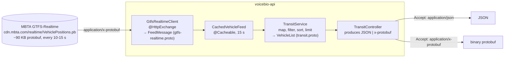

# Protocol Buffers
{: .no_toc }

<details open markdown="block">
  <summary>Contents</summary>
  {: .text-delta }
1. TOC
{:toc}
</details>

## What it does

`GET /api/transit/vehicles` returns **live vehicle positions** of the MBTA (Boston) public transit network. The data
comes from MBTA's public **GTFS-Realtime** feed, the open standard behind realtime transit data in Google Maps, which
is binary [Protocol Buffers](https://protobuf.dev) over HTTP. This service reads that feed and serves its own protobuf
messages, as **binary protobuf or JSON from the same endpoint**, chosen by the `Accept` header.



| Endpoint | Returns |
|---|---|
| `GET /api/transit/vehicles?routeId=Red&limit=50` | `VehicleList`: feed timestamp, vehicles in the feed, the matching vehicles sorted by id. `limit` is 1–1000 (default 100). |
| `GET /api/transit/vehicles/{vehicleId}` | One `Vehicle`, or 404 when it is not in the current feed |

## Two schemas, two roles

| | `gtfs/gtfs-realtime.proto` | `voicebio/transit/v1/transit.proto` |
|---|---|---|
| Owner | The GTFS community (Apache-2.0), vendored unmodified | **Us**: this API's public contract |
| Syntax | proto2: `optional`/`required`, extension ranges | proto3 |
| Size | 28 messages: trips, stops, alerts, occupancy, shapes... | 2 messages + 1 enum |
| Java package | `com.google.transit.realtime` | `com.example.api.transit.v1` |
| Used by | `GtfsRealtimeClient` and `TransitService` only | Controller, service, callers |

`TransitService` maps one to the other, so the upstream format never reaches our callers. This is the same
**anti-corruption layer** as MBTA's JSON:API resources → `RouteDTO` (see [Architecture](architecture.md#two-models-on-purpose)),
but here a schema enforces it. Our contract:

```protobuf
syntax = "proto3";
package voicebio.transit.v1;

import "google/protobuf/timestamp.proto";

option java_package = "com.example.api.transit.v1";
option java_multiple_files = true;

enum VehicleStatus {
  VEHICLE_STATUS_UNSPECIFIED = 0;
  INCOMING_AT = 1;
  STOPPED_AT = 2;
  IN_TRANSIT_TO = 3;
}

message Vehicle {
  string vehicle_id = 1;
  string label = 2;
  string route_id = 3;
  string trip_id = 4;
  double latitude = 5;
  double longitude = 6;
  float bearing = 7;
  float speed_meters_per_second = 8;
  VehicleStatus status = 9;
  string stop_id = 10;
  google.protobuf.Timestamp observed_at = 11;
}

message VehicleList {
  google.protobuf.Timestamp feed_timestamp = 1;
  int32 total_in_feed = 2;
  repeated Vehicle vehicles = 3;
}
```

### Schema evolution rules

Protobuf clients decode by **field number**, not by name, so the numbers are the contract:

* **Never change or reuse a field number.** Removing a field means `reserved 7;` so nobody reuses it.
* **Add fields freely**: old clients skip unknown numbers, new clients see defaults for missing ones.
* **Enum value 0 is "unspecified"**: it is what a client sees when the field is absent.
* **Version in the package** (`voicebio.transit.v1`). A breaking change becomes `v2`, served side by side.
* Prefer **well-known types** (`google.protobuf.Timestamp`) over home-made ones: they map to proper JSON
  (`"2026-11-03T20:54:09Z"`).

## Evolving the schema: `direction_id`

The [Route board](route-board.md) needed each vehicle's direction, which v1 did not carry. It was added the
compatible way, as a **new field number** marked `optional` (proto3 field presence), because `0` is a real direction:

```protobuf
optional int32 direction_id = 12;   // old clients ignore field 12; new ones can tell "0" from "absent"
```

Protobuf clients were unaffected, as designed. A strict JSON schema in a Karate test **did** fail until it listed the
new field: adding fields is backward-compatible only for consumers that tolerate unknown fields.

## Code generation

`protoc` runs during the Maven build. No generated code is committed:

```xml
<plugin>
    <groupId>io.github.ascopes</groupId>
    <artifactId>protobuf-maven-plugin</artifactId>
    <configuration>
        <!-- Spring Boot's parent also adds the gRPC generator; this API uses plain protobuf messages only -->
        <plugins combine.self="override" />
    </configuration>
</plugin>
```

* Spring Boot 4.1 **manages the versions**: `protobuf-java` 4.35.1 and the plugin (5.1.8). The `protoc` binary is
  downloaded to match `protobuf-java`, so runtime and generator never drift apart.
* Every `.proto` under `src/main/proto` is compiled to `target/generated-sources/protobuf`, which IDEs pick up as a
  source folder after a Maven import.
* The vendored `gtfs-realtime.proto` is pinned to upstream commit `474750a` (see `src/main/proto/gtfs/PROVENANCE.md`).
* Generated packages are excluded from Modernizer and Sonar coverage. Generated code is not ours to restyle, and
  the first build failed on Modernizer findings inside `GtfsRealtime.java` until it was excluded.

## Calling a protobuf API

The client is a declarative HTTP interface, exactly like the MBTA V3 client (see [HTTP clients](http-clients.md)):

```java
@HttpExchange(accept = MediaType.APPLICATION_PROTOBUF_VALUE)
public interface GtfsRealtimeClient {
    String GROUP = "transit";

    @GetExchange("/realtime/VehiclePositions.pb")
    FeedMessage vehiclePositions();
}
```

The only protobuf-specific piece is the **message converter**. Spring's `RestClient` has none by default:

```java
static RestClient.Builder customize(RestClient.Builder builder) {
    return builder
        .messageConverters(converters -> converters.addFirst(new ProtobufHttpMessageConverter()))
        .requestInterceptor(OutboundCallLogging.timingLog("Transit feed"))
        .defaultStatusHandler(HttpStatusCode::isError, (request, response) -> {
            throw new TransitFeedException("Transit feed returned HTTP " + response.getStatusCode().value() + ...);
        });
}
```

```yaml
spring.http.serviceclient.transit:
  base-url: https://cdn.mbta.com
  connect-timeout: 5s
  read-timeout: 10s
```

### Mapping proto2 optional fields

What the real feed contains (785 vehicles at the time of writing):

| Field | Present on |
|---|---|
| vehicle id, route, position, status, timestamp | 785 / 785 |
| label | 773 |
| stop id | 771 |
| bearing | 559 |
| speed | **61** |

In proto2, an absent field still returns a default from its getter (`getSpeed()` is `0.0`). Copying blindly would
claim that 724 buses are standing still. The mapper copies only what the agency actually sent:

```java
if (position.getPosition().hasSpeed()) vehicle.setSpeedMetersPerSecond(position.getPosition().getSpeed());
if (position.hasCurrentStatus()) vehicle.setStatus(toStatus(position.getCurrentStatus()));
if (position.hasTimestamp()) vehicle.setObservedAt(timestamp(position.getTimestamp()));
```

Deleted entities (`is_deleted`) and entities that are not vehicles (alerts) are skipped.

{: .lesson }
GTFS sends coordinates as `float`; our contract uses `double`. `(double) 42.21293f` is `42.212928771972656`: binary
noise that looks like false precision. `TransitService.widen` converts through the float's decimal form, giving
`42.21293`. A `float` has about 7 significant digits, which is about 1 m here: plenty for a vehicle, but the first
version of the test expected 8 digits and failed. The test now documents the limit.

### Being a good citizen of a public feed

The feed is regenerated every 10–15 seconds, so `CachedVehicleFeed` keeps the parsed `FeedMessage` for 15 seconds
(`application.cache.transit-feed-time-to-live-seconds`). During the live verification, **12 API reads caused 1
download** of the ~90 KB feed. The cache is a separate bean because `@Cacheable` works through a Spring proxy;
`CachedVehicleFeedIT` proves three reads call the client once.

The **`transit.feed.age`** gauge reports how old the served data is (seconds since MBTA generated the feed). A
steadily growing value means the upstream is stale, which an alert can catch before users notice.

## Serving protobuf and JSON from one endpoint

```java
@RestController
@RequestMapping(value = "/api/transit", produces = { MediaType.APPLICATION_JSON_VALUE, MediaType.APPLICATION_PROTOBUF_VALUE })
public class TransitController {

    @GetMapping("/vehicles")
    public VehicleList getVehicles(@RequestParam(required = false) String routeId,
                                   @RequestParam(defaultValue = "100") @Min(1) @Max(1000) int limit) {
        return transitService.vehicles(routeId, limit);
    }
}
```

The controller returns a **protobuf message**, and one converter bean renders it either way:

```java
@Bean
public ProtobufHttpMessageConverter protobufHttpMessageConverter() {
    return new ProtobufHttpMessageConverter();   // binary, plus JSON via protobuf-java-util
}
```

Verified behaviour:

| Request | Response |
|---|---|
| `Accept: application/json` | `application/json`: protobuf's **canonical JSON** (camelCase, RFC 3339 timestamps, unset fields omitted) |
| `Accept: application/x-protobuf` | `application/x-protobuf` + `X-Protobuf-Message: voicebio.transit.v1.VehicleList` + `X-Protobuf-Schema: voicebio/transit/v1/transit.proto` |
| No `Accept` header | JSON (listed first in `produces`, friendly to browsers and curl) |
| An error, even with `Accept: application/x-protobuf` | `application/problem+json`: errors stay readable |

JSON response (real MBTA data):

```json
{
  "feedTimestamp": "2026-11-03T20:54:13Z",
  "totalInFeed": 786,
  "vehicles": [{
    "vehicleId": "R-548C6902",
    "label": "1908",
    "routeId": "Red",
    "tripId": "77871326",
    "latitude": 42.21293,
    "longitude": -71.00081,
    "bearing": 330.0,
    "status": "IN_TRANSIT_TO",
    "stopId": "70104",
    "observedAt": "2026-11-03T20:54:09Z"
  }]
}
```

### Size

| Same request | JSON | Protobuf |
|---|---|---|
| 50 Red-line vehicles | 6,493 bytes | **1,658 bytes** (3.9×) |
| 50 vehicles, all routes (Karate live run) | 15,220 bytes | **5,195 bytes** (2.9×) |

Protobuf is smaller because field **names** never go over the wire, only field numbers, and numbers use compact
varints. Gzip narrows the gap for large payloads; parsing speed and a typed schema are the other reasons to choose
protobuf.

### Looking inside a binary response

Without the schema, `protoc --decode_raw` shows the wire structure (field numbers instead of names):

```bash
curl -s -H "Authorization: Bearer $TOKEN" -H 'Accept: application/x-protobuf' \
  'localhost:8081/api/transit/vehicles?routeId=Red&limit=1' | protoc --decode_raw
```

```
1 { 1: 1793739253 }          # feed_timestamp.seconds
2: 786                        # total_in_feed
3 {                           # vehicles[0]
  1: "R-548C6902"             #   vehicle_id
  3: "Red"                    #   route_id
  5: 0x40451b4140000000       #   latitude (64-bit double)
  9: 3                        #   status = IN_TRANSIT_TO
  11 { 1: 1793739249 }        #   observed_at.seconds
}
```

In Java (or Karate), decode with the generated class: `VehicleList.parseFrom(bytes)`.

## Errors and validation

| Situation | Response |
|---|---|
| Unknown vehicle | 404 `Vehicle not found` (`VehicleNotFoundException`) |
| `limit` outside 1–1000 | 400 with `fieldErrors: [{field: "limit", message: "must be greater than or equal to 1"}]` |
| Feed returns an error | 502 `Transit feed error` (`TransitFeedException`) |
| No token | 401 |

{: .lesson }
Parameter constraints (`@Min(1) int limit`) raise Spring 7's `HandlerMethodValidationException`, which the generated
`ExceptionTranslator` did not know: the response was a bare `"400 BAD_REQUEST \"Validation failure\""`. It is now
mapped like body validation: `message: error.validation`, `detail: "Invalid request parameters"`, and the same
`fieldErrors` shape.

## Testing

| Test | Proves |
|---|---|
| `TransitServiceTest` (10) | Mapping of every field, optional fields left unset, deleted and non-vehicle entities skipped, filtering, sorting, limit, float widening, feed-age gauge |
| `TransitClientConfigurationTest` (2) | Binary protobuf decoded into `FeedMessage`; `Accept: application/x-protobuf` sent; upstream 503 → `TransitFeedException` |
| `TransitControllerIT` (8) | JSON and binary output, protobuf headers, default format, problem+json on errors, parameter validation, 502, 401 |
| `CachedVehicleFeedIT` (1) | Three reads → one upstream call |
| Karate `transit.feature` (8) | Both formats end to end; binary decoded with `VehicleList.parseFrom(responseBytes)`; protobuf smaller than JSON |

`GtfsFixtures` (test code) builds a realistic feed in Java: a complete vehicle, one with optional fields missing, a
deleted entity and an alert. The same bytes feed the unit tests, the integration tests and the **Karate mock server**
(`mocks/gtfs-realtime-mock.feature`), so `./mvnw verify` never touches the network.

## Best practices

* **Keep your contract separate** from upstream schemas; map at the boundary.
* **Version proto packages** and never reuse field numbers.
* **Generate code at build time** with the protoc version matching the runtime; do not commit generated code.
* **Pin vendored `.proto` files** to a commit and record where they came from.
* **Respect proto2 presence** (`hasX()`) when mapping; defaults are not data.
* **Offer JSON alongside protobuf** from the same endpoint for humans and tools; keep errors as `problem+json`.
* **Cache public feeds** for their update interval and **measure staleness**.
