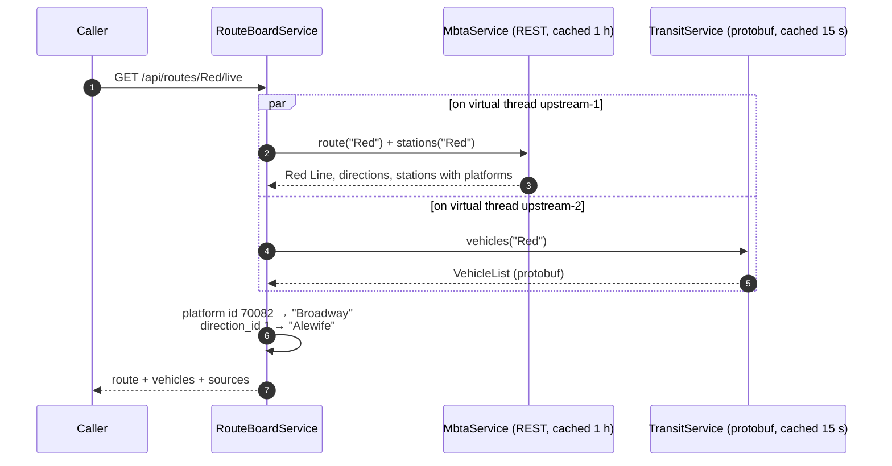

# Route board: combining REST and protobuf
{: .no_toc }

<details open markdown="block">
  <summary>Contents</summary>
  {: .text-delta }
1. TOC
{:toc}
</details>

## What it does

`GET /api/routes/{routeId}/live` answers "where is every train on this line right now, and at which station?". No
single MBTA source can answer that:

| Source | Client | Knows | Does not know |
|---|---|---|---|
| MBTA V3 REST (JSON:API) | `MbtaV3Client` | Route name and colour, direction destinations, **station and platform names** | Where vehicles are now |
| GTFS-Realtime (protobuf) | `GtfsRealtimeClient` | **Live vehicle positions**, status, platform id, direction id | What anything is called |

The route board calls both **in parallel** and joins them:



A real response (live data, trimmed to one vehicle):

```json
{
  "route": {
    "id": "Red", "name": "Red Line", "color": "DA291C", "textColor": "FFFFFF", "kind": "SUBWAY",
    "directions": [
      { "id": 0, "name": "South", "destination": "Ashmont/Braintree" },
      { "id": 1, "name": "North", "destination": "Alewife" }
    ]
  },
  "feedTimestamp": "2026-11-03T21:13:22Z",
  "vehicles": [{
    "vehicleId": "R-548C6902",
    "label": "1908",
    "status": "IN_TRANSIT_TO",
    "directionId": 1,
    "destination": "Alewife",
    "stop": { "id": "70082", "stationId": "place-brdwy", "name": "Broadway", "platform": "Alewife" },
    "latitude": 42.33107,
    "longitude": -71.057,
    "bearing": null,
    "observedAt": "2026-11-03T21:12:58Z"
  }],
  "sources": { "v3": "OK", "gtfsRealtime": "OK" }
}
```

Live result: **22 Red Line vehicles; all 21 at or heading to a stop got their station name.**

## The join

Two keys connect the sources:

| From protobuf (`Vehicle`) | From REST | Result |
|---|---|---|
| `stop_id` = platform id (`70082`) | station's `child_stops` (`include=child_stops`) | station name + platform direction |
| `direction_id` (`1`) | route's `direction_destinations[1]` | destination ("Alewife") |

{: .lesson }
The first V3 query for "the Red Line's stops" (`filter[location_type]=0`) returned **nothing**: V3 lists *parent
stations* (`place-brdwy`) per route, while realtime data reports *platforms* (`70082`). Platforms appear only as
`included` child stops. Check join keys against real data before designing a join.

### Schema evolution in practice: `direction_id`

The destination needs the vehicle's direction, which `transit.proto` v1 did not carry. It was added as a **new field
number**, so existing protobuf clients are unaffected:

```protobuf
// Added after v1 was published, as a new field number: old clients simply ignore it.
// "optional" because 0 is a real direction: without it, "direction 0" and "unknown" would look the same.
optional int32 direction_id = 12;
```

Protobuf clients were indeed unaffected, but the Karate JSON contract test **failed**: it compared the vehicle with a
strict schema (`==`) that did not list `directionId`. Adding a field is backward-compatible only for consumers that
tolerate unknown fields; tell JSON consumers to do so, or document additions as part of your versioning policy.

## Parallel calls on virtual threads

```java
CompletableFuture<ReferenceData> reference = async(() -> new ReferenceData(mbta.route(routeId), mbta.stations(routeId)));
CompletableFuture<VehicleList> positions = async(() -> transit.vehicles(routeId, ALL_VEHICLES));
// both started before waiting on either: total time = the slower call, not the sum

private <T> CompletableFuture<T> async(Supplier<T> call) {
    return CompletableFuture.supplyAsync(call, executor).orTimeout(sourceTimeout.toMillis(), TimeUnit.MILLISECONDS);
}
```

The executor (`config/UpstreamExecutorConfiguration`):

```java
SimpleAsyncTaskExecutor executor = new SimpleAsyncTaskExecutor("upstream-");
executor.setVirtualThreads(true);          // blocking HTTP waits cost almost nothing
executor.setConcurrencyLimit(50);          // virtual threads make it easy to overwhelm a dependency
executor.setTaskDecorator(new MdcTaskDecorator());   // requestId follows the work
```

Why not the common `ForkJoinPool` (the default for `supplyAsync`)? It has few threads, is shared by everything in the
JVM, and loses MDC. A dedicated, named, bounded executor shows up clearly in thread dumps and logs.

Verified: `RouteBoardServiceTest.callsRunInParallel` runs two 300 ms sources in under 550 ms. In the logs and in
Fluentd/Splunk, the parallel work carries the caller's request id:

```json
{"level":"INFO","requestId":"fluent-demo-1","logger":"com.example.service.MbtaService","thread":"upstream-1","message":"Fetching MBTA route Red"}
```

## Partial failure

Each source has a **4-second budget** (`orTimeout`), and its failure is contained:

| Situation | Response |
|---|---|
| Both sources answer | 200, `sources: {v3: OK, gtfsRealtime: OK}` |
| GTFS-Realtime down or slow | 200 with the route and **no vehicles**, `gtfsRealtime: UNAVAILABLE` |
| V3 down or slow | 200 with vehicles **without station names**, `v3: UNAVAILABLE` |
| Unknown route (V3 404) | **404** `Route not found`, even though the feed answered |
| Both down | **502** `Route board unavailable` |

Every degradation increments `route.board.degraded{source=...}`, so a dashboard or alarm shows *which* dependency is
hurting users, even though requests still succeed.

{: .tip }
Partial results are a product decision: here, positions without names are still useful, so they are returned. When a
partial answer would mislead (prices without discounts, say), fail instead. Either way, **say what is missing**
(`sources`) instead of silently returning less.

## Caching makes the combination cheap

| Data | Cache | Lifetime |
|---|---|---|
| Route, stations + platforms | `mbtaRoutes`, `mbtaStations` | 1 h |
| Vehicle feed | `transitFeed` | 15 s |

A board request after warm-up makes **no upstream calls at all**. In the Gatling run, 30 route-board requests (plus
60 others) answered with a p95 of 14 ms while the whole session made 11 calls to MBTA.

## Testing

| Test | Proves |
|---|---|
| `RouteBoardServiceTest` (8) | The join, missing optional data, each source down, timeout within budget, both down (502), unknown route (404), parallelism |
| `RouteBoardControllerIT` (5) | Real service and executor through MVC, degraded response, 404, request-id echo, 401 |
| Karate `route-board.feature` (4) | Every vehicle with a stop has a station name; every direction has a destination; against mocks and live |
