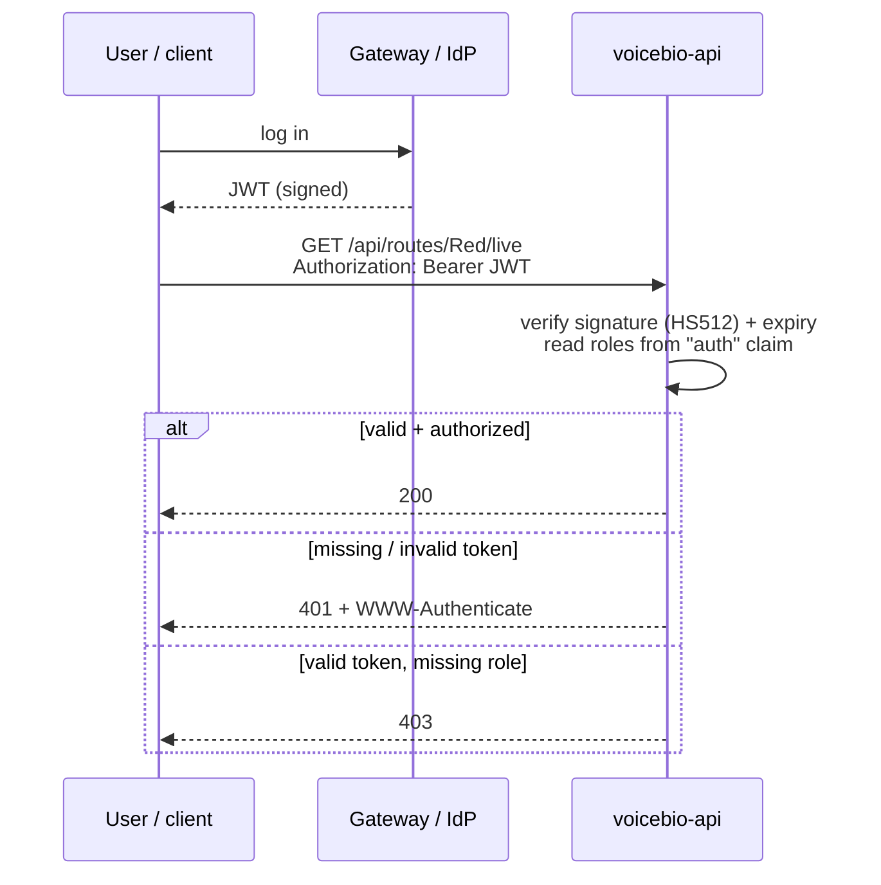

# Security
{: .no_toc }

<details open markdown="block">
  <summary>Contents</summary>
  {: .text-delta }
1. TOC
{:toc}
</details>

## Model: a stateless resource server

This service **does not log users in**. A gateway or identity provider authenticates the user and issues a JWT;
this service only **validates** the token on every request and authorizes based on its claims.



Consequences of being stateless (`SessionCreationPolicy.STATELESS`):

* No HTTP session and no cookies: any instance can serve any request, so scaling out is trivial.
* No CSRF protection is needed (CSRF attacks ride on cookies), so it is disabled.
* "Logout" is token expiry. Keep token lifetimes short.

## Endpoint authorization

From `config/SecurityConfiguration.java`:

```java
http.csrf(csrf -> csrf.disable())
    .authorizeHttpRequests(authz -> authz
        .requestMatchers(HttpMethod.POST, "/api/authenticate").permitAll()
        .requestMatchers(HttpMethod.GET, "/api/authenticate").permitAll()
        .requestMatchers("/api/admin/**").hasAuthority(AuthoritiesConstants.ADMIN)
        .requestMatchers("/api/**").authenticated()
        .requestMatchers("/v3/api-docs/**").hasAuthority(AuthoritiesConstants.ADMIN)
        .requestMatchers("/management/health").permitAll()
        .requestMatchers("/management/health/**").permitAll()
        .requestMatchers("/management/info").permitAll()
        .requestMatchers("/management/prometheus").permitAll()
        .requestMatchers("/management/**").hasAuthority(AuthoritiesConstants.ADMIN))
    .sessionManagement(session -> session.sessionCreationPolicy(SessionCreationPolicy.STATELESS))
    .exceptionHandling(exceptions -> exceptions
        .authenticationEntryPoint(new BearerTokenAuthenticationEntryPoint())
        .accessDeniedHandler(new BearerTokenAccessDeniedHandler()))
    .oauth2ResourceServer(oauth2 -> oauth2.jwt(withDefaults()));
```

| Path | Access | Why |
|---|---|---|
| `/api/authenticate` | Public | Token endpoint (exists only in `dev`, see below) |
| `/api/admin/**` | `ROLE_ADMIN` | Administrative API |
| `/api/**` | Any valid token | The business API: `/api/mbta/**`, `/api/transit/**`, `/api/routes/**` |
| `/v3/api-docs/**` | `ROLE_ADMIN` | The API description is useful reconnaissance for an attacker |
| `/management/health/**`, `/info` | Public | Load balancers and Kubernetes probes have no token |
| `/management/prometheus` | Public | Prometheus scrapes without a token; restrict at the network level |
| `/management/**` | `ROLE_ADMIN` | `env`, `configprops`, `loggers`, `threaddump`... reveal or change internals |

{: .note }
Rules are evaluated **top to bottom, first match wins**. Specific paths must come before broad ones; a
`/management/**` rule placed above `/management/health` would lock out the health probes.

`@EnableMethodSecurity(securedEnabled = true)` is also on, so a method can require a role with
`@PreAuthorize("hasAuthority('ROLE_ADMIN')")` or `@Secured`.

## JWT validation

From `config/SecurityJwtConfiguration.java`:

* **Algorithm**: HMAC **HS512** with a shared secret (`application.security.jwt.base64-secret`).
* **Decoder**: `NimbusJwtDecoder.withSecretKey(...)` checks the signature and `exp`/`nbf`.
* **Roles**: read from the `auth` claim, with no prefix added (`spring.security.oauth2.resourceserver.jwt.authorities-claim-name: auth`,
  `authority-prefix: ''`), so a token with `"auth": ["ROLE_ADMIN"]` has authority `ROLE_ADMIN`.
* **Metrics**: every rejected token increments `security.authentication.invalid-tokens` with a `cause` tag
  (`invalid-signature`, `expired`, `malformed`, `unsupported`), recorded by `SecurityMetersService`. A spike in
  `invalid-signature` is a security signal worth alerting on.

A decoded token looks like this:

```json
{ "alg": "HS512" }
{ "sub": "demo", "auth": ["ROLE_USER", "ROLE_ADMIN"], "iat": 1793740000, "exp": 1793743600 }
```

A missing or bad token gets a standards-compliant challenge (Spring Security 7 adds RFC 9728 metadata):

```
HTTP/1.1 401
WWW-Authenticate: Bearer resource_metadata="http://localhost:8081/.well-known/oauth-protected-resource"
```

### Symmetric vs asymmetric signing

| | HMAC (HS512, today) | RSA/EC (RS256, ES256) via JWKS |
|---|---|---|
| Who can **create** tokens | Anyone holding the shared secret, **including this service** | Only the issuer (holds the private key) |
| Key distribution | The secret must be copied to every service | Services fetch public keys from the issuer's JWKS URL |
| Rotation | Coordinated redeploy | Issuer publishes a new key; services pick it up |
| Config | `base64-secret` | `spring.security.oauth2.resourceserver.jwt.issuer-uri` |

{: .warning }
With HMAC, a compromise of **any** service that holds the secret lets an attacker mint admin tokens for **all** of
them. For production, prefer an asymmetric issuer (for example ADFS, Keycloak, Entra ID or Okta, all of which publish
JWKS). The switch is mostly configuration: replace the HMAC decoder with
`JwtDecoders.fromIssuerLocation(issuerUri)` and map the issuer's role claim.

## The dev-only token endpoint

Developers, Bruno and Gatling need tokens locally, but there is no identity provider on a laptop.
`web/rest/DevTokenController` issues one:

```java
@RestController
@RequestMapping("/api")
@Profile(SpringProfiles.DEVELOPMENT)       // the bean does not exist outside dev
public class DevTokenController {
    @PostMapping("/authenticate")
    public TokenResponse authenticate(@RequestBody(required = false) TokenRequest request) { ... }
}
```

```bash
curl -s -X POST localhost:8081/api/authenticate -H 'Content-Type: application/json' \
  -d '{"username":"alice","authorities":["ROLE_USER"]}'
# {"id_token":"eyJhbGciOiJIUzUxMiJ9...","token_type":"Bearer","expires_in":3600}
```

Safeguards:

* **`@Profile("dev")`**: verified against the prod jar and the Docker image, where `POST /api/authenticate` returns
  **404** because the controller is never created.
* Every issued token is logged at **WARN** (`Issued DEV-ONLY token for 'alice'...`) so it cannot go unnoticed.
* `TokenResponse.toString()` prints `idToken=***`, so the `LoggingAspect` exit trace never writes a usable token to
  the logs. A search of the logs for `eyJ` (how every JWT starts) found none.
* Dev still runs **the full security chain**: tokens are signed and validated exactly as in production. Only the
  token *source* differs.

{: .tip }
Do not disable security in dev "for convenience". Bugs in authorization rules then only show up in production.

## Defence in depth used in this codebase

| Threat | Mitigation | Where |
|---|---|---|
| Log forging (CRLF injection) in messages | `%crlf(%m)` converter replaces `\r\n\t` | `CRLFLogConverter`, `logback-spring.xml` |
| Log forging via the `X-Request-Id` header | Only `[A-Za-z0-9._-]{1,64}` accepted, otherwise a new UUID | `RequestIdFilter` |
| Leaking internals in errors | Package names masked in prod | `ExceptionTranslator` |
| Secrets in logs | Token masked in `toString()` | `DevTokenController.TokenResponse` |
| Clickjacking, MIME sniffing | `X-Frame-Options: DENY`, `X-Content-Type-Options: nosniff` (Spring Security defaults) | response headers |
| Container breakout impact | Image runs as non-root user `1000` | Jib config in `pom.xml` |
| Plain-HTTP URLs in the build | `nohttp` Checkstyle rule | `checkstyle.xml` |
| Exposing ports on the LAN | Compose maps `127.0.0.1:8081:8081`, not `8081:8081` | `src/main/docker/app.yml` |
| Untrusted values in upstream URLs, cache keys, logs | `@Pattern` on path and query parameters | `MbtaController`, `RouteBoardController` |
| Leaking credentials to third parties | MBTA API key sent only to MBTA, only when set; user JWTs never forwarded | `MbtaV3ClientConfiguration` |

## Testing security

* `TokenAuthenticationIT`: valid, expired, wrongly signed and malformed tokens.
* `TokenAuthenticationSecurityMetersIT`: each rejection increments the right `cause` counter.
* `MbtaControllerIT`, `TransitControllerIT`, `RouteBoardControllerIT` `.requiresAuthentication`: no token → 401.
* `@WithMockUser` / `@WithUnauthenticatedMockUser` set the security context in MockMvc tests without real tokens.
* `JwtAuthenticationTestUtils` builds real signed tokens for integration tests.

## Best practices

* **Stateless + bearer tokens** for service-to-service and API traffic.
* **Deny by default**: an explicit rule for every path, ending in a restrictive catch-all.
* **Separate public probes** (`health`) from sensitive actuator endpoints (`env`, `loggers`).
* **Short-lived tokens**; prefer **asymmetric signing** with a JWKS issuer in production.
* **Never weaken security per environment**; gate test-only helpers with `@Profile` and verify they are absent from
  production artifacts.
* **Treat headers as untrusted input**, including headers that end up in logs.
* **Measure authentication failures** and alert on unusual patterns.
