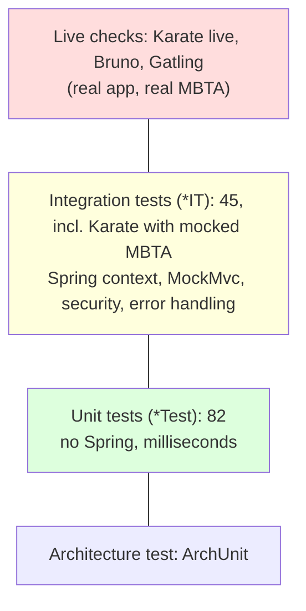

# Testing
{: .no_toc }

<details open markdown="block">
  <summary>Contents</summary>
  {: .text-delta }
1. TOC
{:toc}
</details>

## The test suite

| Kind | Runs in | Count | Examples |
|---|---|---|---|
| Unit tests (`*Test`) | `mvn test` (Surefire) | **82** | `MbtaServiceTest`, `RouteBoardServiceTest`, `MbtaV3ClientConfigurationTest`, `TransitServiceTest` |
| Integration tests (`*IT`) | `mvn verify` (Failsafe) | **45** (1 skipped: live Karate) | `MbtaControllerIT`, `RouteBoardControllerIT`, `TransitControllerIT`, `ObservabilityExportersIT` |
| Karate API tests | Failsafe (`KarateApiIT`) / on demand (`KarateLiveIT`) | 21 self-contained, 25 live scenarios | `mbta.feature`, `route-board.feature`, `transit.feature` |
| Architecture test | Surefire | 1 | `TechnicalStructureTest` (ArchUnit) |
| BDD scenarios | Surefire | 2 | `CucumberTest` |
| Load test | On demand | 1 simulation | `MbtaSimulation` (Gatling) |
| Live API checks | On demand (Bruno CLI) | 30 requests, 40 tests | `bruno/` collection |

Everything runs on **JDK 21** (the enforcer rejects other versions):

```bash
./mvnw test        # unit tests only, seconds
./mvnw verify      # unit + integration tests, including self-contained Karate (what CI runs)
./mvnw -Pprod verify
```

### The pyramid



Many fast tests at the bottom, fewer broad ones at the top. Each layer catches different bugs (see
[lessons](#lessons-what-each-layer-caught)).

## Unit tests: no Spring needed

Constructor injection makes every class testable with `new`. Clients are interfaces, so services are tested against
plain Mockito mocks, fed with **real-shaped fixtures**:

```java
class MbtaServiceTest {
    private final MbtaV3Client client = mock(MbtaV3Client.class);
    private final MbtaService service = new MbtaService(client);

    @Test
    void stationsKeepOnlyTheirBoardingPlatforms() throws IOException {
        when(client.stationsWithPlatforms("Red")).thenReturn(read("stations-red.json", new TypeReference<>() {}));

        var stations = service.stations("Red");

        assertThat(stations.getFirst().platforms())
            .containsExactly(new PlatformDTO("70085", "Ashmont/Braintree"), new PlatformDTO("70089", "Alewife")); // the entrance is not a platform
    }
}
```

Concurrency is unit-tested too, with a real virtual-thread executor and controlled delays:

```java
@Test
void slowSourceTimesOutInsteadOfHoldingTheRequest() {
    when(mbta.stations("Red")).thenAnswer(invocation -> { Thread.sleep(3_000); return STATIONS; });

    long start = System.nanoTime();
    var board = service.liveBoard("Red");                         // 500 ms budget in this test

    assertThat(Duration.ofNanos(System.nanoTime() - start)).isLessThan(Duration.ofSeconds(2));
    assertThat(board.sources()).containsEntry("v3", SourceStatus.UNAVAILABLE);
    assertThat(board.vehicles()).hasSize(2);                      // the other source still delivered
}
```

The time budget is a package-private constructor parameter, so the test does not wait for the production 4 seconds.

## Test fixtures

| Fixture | Format | Used by |
|---|---|---|
| `src/test/resources/fixtures/mbta/*.json` | JSON:API documents shaped like real MBTA responses (routes, stations with included platforms, predictions, alerts, a 404 error) | Client test, service test, Karate V3 mock |
| `GtfsFixtures` (Java) | A GTFS-Realtime `FeedMessage`: a complete vehicle, one with optional fields missing, a deleted entity, an alert | Transit and route-board tests, Karate protobuf mock |

The two are **consistent with each other**: vehicle `R-1` reports platform `70089`, which the stations fixture names
"JFK/UMass" (platform "Alewife"). The same join works in unit tests, integration tests and Karate.

## Testing HTTP clients: `MockRestServiceServer`

The real `@HttpExchange` proxy plus the real customization, on a mocked server:

```java
RestClient.Builder builder = MbtaV3ClientConfiguration.customize(RestClient.builder().baseUrl(BASE_URL), apiKey, remaining, clock);
server = MockRestServiceServer.bindTo(builder).build();
client = HttpServiceProxyFactory.builderFor(RestClientAdapter.create(builder.build())).build().createClient(MbtaV3Client.class);
```

```java
@Test
void rateLimitedBecomesRetryableWithTheResetTime() {
    server.expect(requestTo(BASE_URL + "/routes/Red"))
        .andRespond(withStatus(HttpStatus.TOO_MANY_REQUESTS).header("x-ratelimit-reset", String.valueOf(NOW.getEpochSecond() + 42)));

    assertThatThrownBy(() -> client.route("Red"))
        .isInstanceOfSatisfying(MbtaRateLimitedException.class, e -> assertThat(e.retryAfterSeconds()).isEqualTo(42));
}
```

These tests pin the exact wire behaviour: encoded bracket parameters (`filter%5Btype%5D=0%2C1`), the `Accept` header,
the API key only when configured, relationship parsing (object, array and `null`), and each error status. The protobuf
client is tested the same way with binary bodies (`TransitClientConfigurationTest`).

## Integration tests: the real web stack

```java
@IntegrationTest            // @SpringBootTest of the whole application
@AutoConfigureMockMvc       // real filters, security, validation, error handling; no network
@WithMockUser
class RouteBoardControllerIT {
    @MockitoBean private MbtaService mbtaService;    // only the two sources are mocked:
    @MockitoBean private CachedVehicleFeed feed;     // the real RouteBoardService, executor and mapping run

    @Test
    void degradesWhenTheFeedIsDown() throws Exception {
        when(feed.vehiclePositions()).thenThrow(new TransitFeedException("Transit feed returned HTTP 503 ..."));

        mockMvc.perform(get("/api/routes/Red/live"))
            .andExpect(status().isOk())
            .andExpect(jsonPath("$.sources.gtfsRealtime").value("UNAVAILABLE"))
            .andExpect(jsonPath("$.route.name").value("Red Line"));
    }
}
```

Integration tests prove what unit tests cannot: URL mappings, JSON and protobuf rendering, content negotiation,
parameter validation (`MbtaControllerIT.pathValuesAreValidatedBeforeReachingUpstream`), RFC 7807 bodies and headers
(`Retry-After: 42` on a rate-limited upstream), security, and the request-id filter.

`ObservabilityExportersIT` loads the **real** `application-<profile>.yml` files and checks which metric registries each
profile creates (default: Prometheus only; `dynatrace`: Dynatrace without any token; `datadog`: Datadog).

### Test infrastructure worth knowing

| Piece | Purpose |
|---|---|
| `@IntegrationTest` | `@SpringBootTest(classes = {VoicebioApiApp.class, AsyncSyncConfiguration.class})` |
| `AsyncSyncConfiguration` | `@Async` runs inline in tests, for determinism |
| `SpringBootTestClassOrderer` | Plain tests before `@IntegrationTest` classes (fast feedback first) |
| `junit-platform.properties` | 15 s default timeout per test |
| `JwtAuthenticationTestUtils` | Real signed, expired or malformed tokens |
| `src/test/resources/config/application.yml` | **Replaces** the main `application.yml` in tests, so exporter-off settings are repeated there |

## Karate API tests

[Karate](https://karatelabs.github.io/karate/) tests the HTTP API as a black box in readable `.feature` files.

```
src/test/resources/
├── karate-config.js                        baseUrl + token (must be at the classpath root)
└── karate/
    ├── common/get-token.feature            dev token, fetched once per run when none is given
    ├── mbta/mbta.feature                   @mbta: routes, stations, predictions, alerts, 404, validation
    ├── routes/route-board.feature          @board: the combined endpoint, names joined to positions
    ├── transit/transit.feature             @transit: protobuf and JSON, decoded with the generated class
    ├── observability/observability.feature @live: metrics, cache hits, URI templates, Prometheus names
    └── mocks/
        ├── mbta-v3-mock.feature            serves the JSON:API fixtures with MBTA's headers
        └── gtfs-realtime-mock.feature      serves GtfsFixtures as binary protobuf
```

```gherkin
Scenario: both sources merged
  Given path '/api/routes/Red/live'
  When method get
  Then status 200
  And match response.sources == { v3: 'OK', gtfsRealtime: 'OK' }
  * def withStop = karate.filter(response.vehicles, function(v){ return v.stop != null })
  * def named = karate.filter(withStop, function(v){ return v.stop.name != null })
  * assert named.length == withStop.length
```

| Runner | When | Target | Upstreams |
|---|---|---|---|
| `KarateApiIT` | Every `./mvnw verify` | App on a random port | **Karate mocks** of MBTA V3 and the GTFS feed: no network |
| `KarateLiveIT` | On demand | Any running instance (`-Dkarate.baseUrl`) | The real MBTA APIs |

```bash
./mvnw                                   # terminal 1
./mvnw test-compile failsafe:integration-test failsafe:verify -Dit.test=KarateLiveIT -Dkarate.baseUrl=http://localhost:8081
```

Results: **21/21** self-contained; **25/25** live (Red Line board: 22 vehicles, all 21 at a stop named).
Reports: `target/karate-reports/{self-contained,live}/karate-summary.html`.

{: .warning }
Without an `MBTA_API_KEY`, MBTA allows 20 requests per minute. A live run makes about 7 MBTA calls thanks to
caching; running it repeatedly in a short time against a fresh app can hit the limit (you would see 503 with
`Retry-After`). Set `MBTA_API_KEY` for CI jobs that run live tests.

{: .warning }
Do not run `./mvnw verify` against an app started with `java -jar target/*.jar`: `verify` repackages that jar while the
JVM runs from it, and the app fails with `NoClassDefFoundError`. Start the app with `./mvnw` or a container.

## Bruno collection

`bruno/` holds 30 requests with 40 tests, for interactive demos and manual checks. Run the whole collection with the
Bruno CLI against a running app:

```bash
./mvnw                                                     # terminal 1
cd bruno && npx --yes @usebruno/cli@4.3.0 run --env local  # terminal 2
```

Folders run in name order: **1 Auth → 2 MBTA V3 → 4 Transit → 5 Route board → 6 Observability**. Observability runs
last on purpose: it inspects the metrics, cache hits and timers that the earlier requests produced. Verified with the
CLI against a freshly started app: 30/30 requests, 40/40 tests, 9 calls to MBTA.

{: .lesson }
The first CLI run failed 3 requests that a `curl` replay had passed: the observability folder ran *before* the traffic
it was meant to observe, and a URL contained raw `{routeId}` braces, which Tomcat rejects in a query string with 400
(the hand-written `curl` had them percent-encoded). Run collections with the tool your team uses, not an imitation.

{: .warning }
A cold run makes about 9 MBTA calls; MBTA allows 20 per minute without a key, counted per client. Two cold runs within
a minute can return 503 `MBTA API rate limited`. Set `MBTA_API_KEY`, or wait for the `Retry-After`.

## Architecture tests

`TechnicalStructureTest` fails the build when a dependency breaks the layering ([Architecture](architecture.md)). It
guided several designs here: `RetryableFailure` and `SpringProfiles` live in the root package because both the client
and web layers need them.

## Lessons: what each layer caught

| Bug | Caught by | Missed by |
|---|---|---|
| Alert headers (`X-voicebioApi-error`) never sent | Integration test | Generated tests (none checked headers) |
| PATCH sent `"title": null`, erasing data (earlier Todo client) | Live API check | Unit tests: the body was not asserted |
| A counter renamed by Prometheus (`_created` suffix) | Live scrape | `SimpleMeterRegistry` in unit tests |
| Lombok packaged into the production jar | Inspecting the jar | All tests |
| `./mvnw` never started (missing `no.yml`) | Running the documented command | Every `java -jar` check |
| Adding `direction_id` broke a strict JSON schema | Karate contract test | Protobuf clients (they ignore new fields, by design) |
| Empty `${VAR:}` default disabled Dynatrace export silently | Capture server on OneAgent's port | Startup (nothing failed) |
| Bruno: raw `{routeId}` in a query string (Tomcat 400); folder order | Running the real Bruno CLI | A hand-written `curl` replay |
| `filter[location_type]=0` returned no platforms | Probing the real V3 API | Would have been a fixture-shaped assumption |

{: .lesson }
Mocks encode your assumptions. Every boundary needs at least one check against the real thing (live API, real Fluentd,
a capture server on the real port, the built artifact), and every finding becomes a fast regression test.

## Best practices

* **Test behaviour, not implementation**: outputs, status codes, bodies, headers, metrics.
* **Unit-test business logic without Spring**, including concurrency and timeouts with controlled delays.
* **Real-shaped, mutually consistent fixtures** shared by every test level.
* **Integration-test the web layer** with MockMvc: mappings, validation, security, error format.
* **Test HTTP clients** against a mocked server, asserting the exact request.
* **Run API tests both against mocks (CI) and live** (on demand).
* **Enforce architecture** with ArchUnit.
* **Verify against reality** once per boundary, then pin findings with fast tests.
