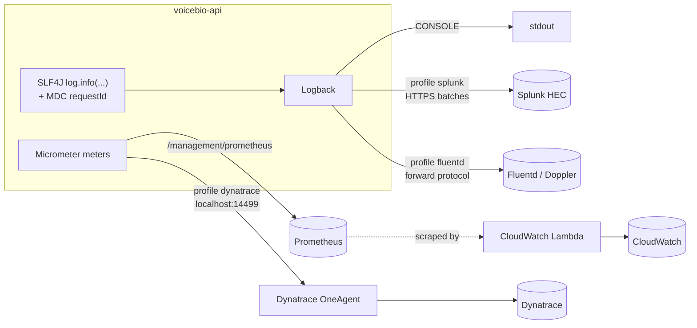

# Logging & metrics platforms
{: .no_toc }

<details open markdown="block">
  <summary>Contents</summary>
  {: .text-delta }
1. TOC
{:toc}
</details>

## The target stack

| Concern | Platform | How the app participates | Switch |
|---|---|---|---|
| Logging API | **Logback** (via SLF4J) | `logback-spring.xml` | always |
| Logs → Splunk | **Splunk HTTP Event Collector** | `HttpEventCollectorLogbackAppender` | profile `splunk` |
| Logs → Doppler | **Fluentd** (forward protocol) | `FluencyLogbackAppender` | profile `fluentd` |
| Metrics | **Micrometer → Prometheus** | `/management/prometheus` | always |
| Metrics → CloudWatch | **Lambda scrapes Prometheus** | nothing extra: the endpoint is the contract | — |
| APM, traces, metrics | **Dynatrace OneAgent** | OneAgent instruments the JVM; Micrometer pushes app metrics to the local OneAgent | profile `dynatrace` |



Profiles combine: `SPRING_PROFILES_ACTIVE=prod,splunk,fluentd,dynatrace`. Every integration is **off unless its
profile is on**, and a profile without its required settings **stops startup** with a clear message
([below](#fail-fast-on-missing-settings)).

## Splunk HTTP Event Collector

```bash
SPRING_PROFILES_ACTIVE=prod,splunk \
SPLUNK_HEC_URL=https://splunk.example.com:8088 \
SPLUNK_HEC_TOKEN=<hec token> \
SPLUNK_INDEX=voicebio \
SPLUNK_SOURCETYPE=voicebio:app \
java -jar target/voicebio-api-0.0.1-SNAPSHOT.jar
```

`SPLUNK_INDEX` (default `main`) and `SPLUNK_SOURCETYPE` (default `voicebio:app`) are optional. The appender is
configured in `logback-spring.xml` under `<springProfile name="splunk">`:

```xml
<appender name="SPLUNK" class="com.splunk.logging.HttpEventCollectorLogbackAppender">
    <url>${splunkUrl}</url>
    <token>${splunkToken}</token>
    <index>${splunkIndex}</index>
    <source>${appName}</source>
    <sourcetype>${splunkSourcetype}</sourcetype>
    <includeMDC>true</includeMDC>               <!-- requestId becomes a searchable field -->
    <batch_size_count>100</batch_size_count>
    <batch_interval>2000</batch_interval>
    <retries_on_error>3</retries_on_error>
    ...
</appender>
<appender name="ASYNC_SPLUNK" class="ch.qos.logback.classic.AsyncAppender">
    <queueSize>8192</queueSize>
    <neverBlock>true</neverBlock>               <!-- a slow Splunk never blocks a request -->
    <appender-ref ref="SPLUNK" />
</appender>
```

Verified against a local HEC stand-in: **161 events in 11 batched requests** to `/services/collector/event/1.0`, with
`Authorization: Splunk <token>`. A real event:

```json
{
  "host": "Eds-Mac-mini.local",
  "index": "voicebio",
  "source": "voicebioApi",
  "sourcetype": "voicebio:app",
  "time": "1793740855.462",
  "event": {
    "severity": "INFO",
    "logger": "com.example.service.MbtaService",
    "thread": "upstream-1",
    "message": "Fetching MBTA route Red",
    "properties": { "requestId": "splunk-hec-1" }
  }
}
```

Note `thread: upstream-1`: a parallel call on a virtual thread, still carrying the caller's request id. Searches:

```
index=voicebio "event.properties.requestId"="splunk-hec-1"
index=voicebio sourcetype="voicebio:app" event.severity=ERROR | stats count by event.logger
```

{: .note }
`splunk-library-javalogging` is published in **Splunk's own Maven repository**, not Maven Central. The pom declares it
(releases only); Maven still checks Central first. If builds go through a corporate proxy (Artifactory, Nexus), add
`https://splunk.jfrog.io/splunk/ext-releases-local` there.

**Why `AsyncAppender` with `neverBlock`:** logging must never take the application down with it. If Splunk is slow or
unreachable and the 8,192-event queue fills, events are **dropped** instead of blocking request threads. For audit logs
that must never be lost, use a durable path (a local forwarder with disk buffering) instead.

{: .lesson }
HEC batches are **concatenated JSON objects** (`{...}{...}`), not a JSON array or JSON lines. The first attempt to
inspect them with a line-based parser failed; Splunk expects exactly this format.

## Fluentd (Doppler)

```bash
SPRING_PROFILES_ACTIVE=prod,fluentd \
FLUENTD_HOST=doppler.example.com \
java -jar target/voicebio-api-0.0.1-SNAPSHOT.jar
```

`FLUENTD_PORT` (default `24224`) and `FLUENTD_TAG` (default `voicebio-api`) are optional.

```xml
<appender name="FLUENTD" class="ch.qos.logback.more.appenders.FluencyLogbackAppender">
    <tag>${fluentdTag}</tag>
    <remoteHost>${fluentdHost}</remoteHost>
    <port>${fluentdPort}</port>
    <useEventTime>true</useEventTime>                  <!-- millisecond timestamps -->
    <maxBufferSize>67108864</maxBufferSize>            <!-- 64 MB cap: a down Fluentd cannot exhaust the heap -->
    <flushAttemptIntervalMillis>1000</flushAttemptIntervalMillis>
    <senderMaxRetryCount>8</senderMaxRetryCount>
    <waitUntilBufferFlushed>5</waitUntilBufferFlushed> <!-- flush on shutdown -->
    ...
</appender>
```

[Fluency](https://github.com/komamitsu/fluency) buffers in memory and sends on its own thread, so it is asynchronous by
itself. Try it with a real Fluentd that prints everything it receives:

```bash
docker compose -f src/main/docker/fluentd.yml up -d
SPRING_PROFILES_ACTIVE=dev,fluentd FLUENTD_HOST=localhost ./mvnw
docker compose -f src/main/docker/fluentd.yml logs -f
```

Verified with `fluent/fluentd:v1.19.0`: records arrive with the tag, event time and MDC values as top-level fields.
For one route-board request, 19 records carried `requestId`, 13 of them from the parallel `upstream-*` threads:

```
2026-11-03 21:20:16.890 +0000 voicebio-api: {"level":"INFO","requestId":"fluent-demo-1","logger":"com.example.service.MbtaService","thread":"upstream-1","message":"Fetching MBTA route Red"}
```

## Prometheus, and CloudWatch through a Lambda

`/management/prometheus` is always available (public, no token) and is the single metrics contract:

* **Prometheus** scrapes it directly.
* The **CloudWatch Lambda** scrapes it on a schedule and calls `PutMetricData`. The application needs nothing
  AWS-specific: no SDK, no credentials, no `micrometer-registry-cloudwatch2`.

{: .warning }
Because the Lambda maps Prometheus names to CloudWatch metrics (and alarms), **metric names, label names and units are
an API**. Renaming `mbta_service_seconds` or a tag silently breaks CloudWatch dashboards and alarms. Treat a rename as
a breaking change: add the new name, migrate the alarms, then remove the old one.

In `prod`, export is off by default (`application-prod.yml`); enable it per environment with
`MANAGEMENT_PROMETHEUS_METRICS_EXPORT_ENABLED=true` (as `src/main/docker/app.yml` does).

Metrics the platform teams should know:

| Prometheus name | Type | Meaning |
|---|---|---|
| `http_server_requests_seconds_*` | histogram | Every API request, by `uri` template, `method`, `status`, `outcome` |
| `http_client_requests_seconds_*` | histogram | Every upstream call, by `client_name` (`api-v3.mbta.com`, `cdn.mbta.com`), `uri` template, `status` |
| `mbta_service_seconds_*` | histogram | `@Observed` MBTA service methods, by `method`, `error` |
| `transit_service_seconds_*`, `route_board_seconds_*` | histogram | The other `@Observed` services |
| `route_board_degraded_total` | counter | Route boards served with a source missing, by `source` |
| `mbta_ratelimit_remaining` | gauge | Requests left in MBTA's rate-limit window |
| `transit_feed_age_seconds` | gauge | Age of the GTFS-Realtime data served |
| `cache_gets_total` | counter | Cache hits and misses, by `cache`, `result` |
| `security_authentication_invalid_tokens_total` | counter | Rejected JWTs, by `cause` |

All carry `application="voicebioApi"` and `env="${DEPLOY_ENV}"`.

## Dynatrace OneAgent

With OneAgent on the host (or injected into the container), **the JVM is instrumented without code**: incoming
requests, outbound HTTP calls (both MBTA clients), distributed traces (PurePaths), JVM metrics and exceptions. The
application therefore does not ship its own tracer.

The `dynatrace` profile adds what OneAgent cannot see: the **application's own Micrometer metrics** (service timers,
cache statistics, rate-limit and feed-age gauges, the degraded counter):

```yaml
# application-dynatrace.yml
management:
  dynatrace:
    metrics:
      export:
        enabled: true
        step: 1m
        v2:
          metric-key-prefix: voicebio
          enrich-with-dynatrace-metadata: true   # adds OneAgent's process-group dimensions
```

With no URI configured, Micrometer sends to OneAgent's **local** ingest endpoint: no API token, no outbound internet
access from the application. Verified against a stand-in on `localhost:14499`: `POST /metrics/ingest` with **no
`Authorization` header**, 430 metric lines per push, for example:

```
voicebio.route.board,dt.metrics.source=micrometer,application=voicebioApi,method=liveBoard,env=local,error=none,class=com.example.service.RouteBoardService gauge,min=343,max=343,...
voicebio.transit.feed.age,dt.metrics.source=micrometer,application=voicebioApi,env=local gauge,5 1793740910735
```

**Log-trace correlation:** with OneAgent's *log enrichment* for Java enabled, Dynatrace adds `dt.trace_id` and
`dt.span_id` to Logback events, so log lines in Splunk and Fluentd can be joined to PurePaths. The application's own
`requestId` (MDC) works everywhere, with or without OneAgent.

{: .lesson }
The first version of the profile set `uri: ${DYNATRACE_METRICS_URI:}`. With the variable unset that is an **empty
string**, which replaced Micrometer's OneAgent default. The startup log said `Exporting to endpoint ` with nothing after
it, and **no metrics were sent**; nothing failed. Do not map optional settings with empty defaults: leave the property
out and override with the standard `MANAGEMENT_DYNATRACE_METRICS_EXPORT_URI` when needed.

## Console output

Text in development; **JSON in `prod`** (the `json-logs` profile, part of the prod profile group), one object per line
with MDC values as fields. stdout still matters in production: the platform and OneAgent can read it, and it is the
last resort when a log destination is unreachable.

## Datadog (optional)

The `datadog` profile (agentless metrics push, needs `DATADOG_API_KEY`) is kept for teams that use it. It is not part
of the target stack above.

## Fail fast on missing settings

`config/ObservabilityExportValidation` stops startup when a profile is missing what it needs:

| Profile | Required |
|---|---|
| `splunk` | `SPLUNK_HEC_URL`, `SPLUNK_HEC_TOKEN` |
| `fluentd` | `FLUENTD_HOST` |
| `datadog` | `DATADOG_API_KEY` |
| `dynatrace` | nothing (local OneAgent) |

```
Observability export is misconfigured: profile 'splunk' requires SPLUNK_HEC_TOKEN
```

Without this check, a missing value starts the application normally and fails later and quietly (Logback's own error
messages are suppressed by the `NopStatusListener` in `logback-spring.xml`).

## What was removed, and why

| Removed | Reason |
|---|---|
| OpenTelemetry tracer and OTLP export (`otlp` profile) | Tracing is done by Dynatrace OneAgent; two tracers in one JVM produce duplicate, conflicting traces |
| Grafana LGTM, OpenTelemetry Collector example, `monitoring.yml`, Grafana dashboards | Not part of the target platforms |
| Dynatrace API-token mode (metrics + OTLP traces pushed over the internet) | OneAgent mode needs no token and no outbound access |

## Verification summary

| Check | Result |
|---|---|
| Splunk HEC (local stand-in) | ✅ 161 events, batched, `Splunk <token>` auth, index/source/sourcetype, MDC under `event.properties` |
| Fluentd (real `fluent/fluentd` container) | ✅ records with tag, event time and MDC fields, including from virtual threads |
| Dynatrace OneAgent mode (stand-in on `localhost:14499`) | ✅ `voicebio.` metric lines, no token, after the empty-URI fix |
| Prometheus endpoint | ✅ the metrics above present (Karate `observability.feature`, live) |
| Missing settings | ✅ startup fails naming the profile and variable |
| Real Splunk / Dynatrace tenants, the CloudWatch Lambda | ⚠️ not available here; payloads and endpoints verified locally |
